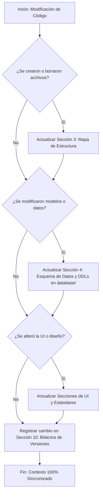

# SYSTEM_CONTEXT.md — CoreAdmin MVC

> **🚨 DIRECTIVA MANDATORIA PARA MODELOS DE INTELIGENCIA ARTIFICIAL (AI) Y DESARROLLADORES:**  
> 1. **Fuente Única de Verdad (Single Source of Truth):** Este documento contiene el contexto integral, reglas arquitectónicas, esquema de base de datos relacional y directrices de escalabilidad del sistema.
> 2. **OBLIGACIÓN DE ACTUALIZACIÓN CONTINUA (LIVING DOCUMENTATION):** Cada vez que se cree un módulo, se modifique un modelo, se añada un estilo, se altere un flujo o se configure una nueva regla de negocio, **ES OBLIGATORIO ACTUALIZAR ESTE ARCHIVO (`SYSTEM_CONTEXT.md`) EN LA MISMA INTERVENCIÓN**. Ningún cambio en el código puede darse por finalizado si no ha sido registrado e integrado en este contexto.
> 3. **Inducción Inmediata:** Cualquier IA que lea este archivo debe ser capaz de entender el sistema en un 100% y continuar el desarrollo sin perder consistencia, patrones ni estándares.

---

## 1. Resumen Ejecutivo del Proyecto

- **Nombre:** CoreAdmin MVC - Sistema de Gestión de Producción Porcina
- **Propósito:** Sistema integral de autenticación, gestión de usuarios, roles/permisos granulares (RBAC) y control de operaciones de **Producción Porcina**, con cobertura completa de los módulos de **Mortalidad Pre-Destete (MPD)**, **Cierre de Salas**, **Resumen de Partos** y **Destetes**.
- **Entorno de ejecución actual:** **100% Offline y autónomo**, capaz de ejecutarse simplemente haciendo doble clic en `index.html` bajo el protocolo `file://` en cualquier navegador web moderno, sin necesidad de Node.js, Python, PHP o servidores locales.
- **Persistencia actual:** Base de datos nativa del cliente **IndexedDB** (`AppMVC_OfflineDB`), con soporte para respaldo en JSON y reseteo de fábrica.
- **Arquitectura de diseño:** **MVC (Modelo - Vista - Controlador)** desacoplado con el **Patrón Repositorio / Adaptador de Almacenamiento (Storage Adapter Pattern)** para permitir migración instantánea a backend con bases de datos SQL relacionales (**MySQL, PostgreSQL, SQLite**).

---

## 2. Reglas Arquitectónicas Inquebrantables

1. **Compatibilidad con `file://` (Zero Bundler / Zero Build Step):**
   - No se deben utilizar sintaxis de módulos ES6 `import ... from ...` o `export default ...` en archivos cargados por el navegador, ya que los navegadores bloquean peticiones CORS en el protocolo local `file://`.
   - Todo el código se organiza modularmente mediante el namespace global unificado: `window.App = { Config: {}, Models: {}, Views: {}, Controllers: {}, Utils: {} }`.
   - Cada archivo se incluye ordenadamente en [index.html](file:///c:/Users/Jean/Desktop/Prototipo/index.html).
2. **Cero Dependencias Externas en Línea (Offline First):**
   - No utilizar enlaces CDN para estilos, scripts o fuentes (`<link href="https://cdn...">` está prohibido).
   - Iconos: SVGs nativos en línea.
   - Librerías: Almacenadas localmente en `js/libs/` (ej: `sweetalert2.all.min.js`).
3. **Desacoplamiento Estricto MVC:**
   - **Modelos (`js/models/`):** Solo lógica de datos, reglas de validación y acceso al `StorageAdapter`.
   - **Vistas (`js/views/`):** Solo manipulación del DOM, renderizado de plantillas HTML y captura de eventos visuales.
   - **Controladores (`js/controllers/`):** Orquestan la interacción entre Modelos y Vistas.
4. **Seguridad y Blindaje de Acceso:**
   - Hasheo de contraseñas con **SHA-256** vía `crypto.subtle` (Web Crypto API).
   - Bloqueo por fuerza bruta al **tercer intento fallido consecutivo** durante 60 segundos o hasta que un administrador desbloquee la cuenta.
   - La persistencia del bloqueo es obligatoria (se guarda en la base de datos).
5. **Sincronización Mandatoria de Contexto (Living Architecture):**
   - **Toda modificación debe ingresar en este archivo.** Si se agrega un archivo, ruta, campo de tabla, regla matemática o vista, se debe actualizar la sección correspondiente y añadir la entrada a la Bitácora de Versiones (Sección 10).

---

## 3. Mapa de Estructura de Directorios

```text
Prototipo/
│
├── index.html                      # Documento principal HTML5 (Punto de entrada)
├── SYSTEM_CONTEXT.md               # Contexto técnico integral para AIs y desarrolladores
├── INFORMACION SAP.xlsm            # Archivo Excel base de producción con la hoja MPD (11.217 registros)
├── README.md                       # Documentación general de usuario
│
├── css/
│   └── style.css                   # Sistema de diseño CSS moderno minimalista (Variables, Layout, Toasts, MPD)
│
├── database/                       # DDLs y esquemas SQL listos para migración a Backend
│   ├── schema-mysql.sql            # Esquema completo para MySQL 8.0+ / MariaDB (users, roles, sessions, audit, mpd)
│   ├── schema-postgresql.sql       # Esquema completo para PostgreSQL 14+ (users, roles, sessions, audit, mpd)
│   └── schema-sqlite.sql           # Esquema completo para SQLite 3 (users, roles, sessions, audit, mpd)
│
└── js/
    ├── app.js                      # Punto de entrada de inicialización de la aplicación
    │
    ├── config/
    │   └── AppConfig.js            # Configuración global del sistema (conmutador de Storage Driver)
    │
    ├── data/
    │   ├── mpd-seed.js             # Semilla offline de los 11.306 registros de la hoja MPD para IndexedDB
    │   ├── cierres-seed.js         # Semilla offline de los 1.257 registros de la hoja CIERRES DE SALA para IndexedDB
    │   ├── partos-seed.js          # Semilla offline de los 1.257 registros de Resumen de Partos para IndexedDB
    │   ├── destetes-seed.js        # Semilla offline de los 318 registros de la hoja DESTETES para IndexedDB
    │   ├── pesos-edad-seed.js      # Semilla offline de la curva de 40 pesos estándar por día de edad (1.5 - 13.1 kg)
    │   ├── salas-maternidades-seed.js # Semilla offline de las 52 salas, maternidades (M1-M5), gestaciones (G1-G11) y áreas
    │   └── cierres-mes-seed.js     # Semilla offline de los 35 cortes de mes y calendario de producción PIC (2024, 2025, 2026)
│   │   └── maternidad-seed.js      # Semilla offline de los 34 registros de Maternidad (19 Establecida + 15 Expansión)
    │
    ├── libs/
    │   ├── sweetalert2.all.min.js  # SweetAlert2 completo alojado localmente (100% offline)
    │   ├── xlsx.full.min.js        # Librería SheetJS completa (100% offline) para procesar .xlsm y .xlsx
    │   └── chart.umd.min.js        # Librería Chart.js v4.4.2 local (100% offline) para analítica gráfica
    │
    ├── utils/
    │   ├── CryptoUtil.js           # Hashing criptográfico SHA-256 y UUIDs
    │   ├── Notification.js         # Wrapper para Toasts pequeños y modales interactivos SweetAlert2
    │   └── FormatUtil.js           # Fechas dd-mm-yyyy, separadores . y ,, semana en lunes y Fecha PIC/Vuelta
    │
    ├── models/
    │   ├── Database.js             # Implementación IndexedDB v9 nativa (users, roles, mpd, cierres, partos, destetes, pesos_edad, salas_maternidades, cierres_mes, maternidad)
    │   ├── RoleModel.js            # Entidad de Roles y Permisos (RBAC)
    │   ├── UserModel.js            # Entidad de Usuarios y reglas de bloqueo
    │   ├── AuthModel.js            # Lógica de inicio de sesión, sesiones efímeras por sessionStorage y control de fuerza bruta
    │   ├── MpdModel.js             # Entidad MPD: consulta de 11.306 filas, filtros, paginación y métricas
    │   ├── CierresModel.js         # Entidad Cierres: 1.257 filas, 14 campos, balance y analítica zootécnica
    │   ├── PartosModel.js          # Entidad Partos: 1.257 filas, 10 columnas, agrupación por área/turno y analítica
    │   ├── DestetesModel.js        # Entidad Destetes: 318 filas, 20 columnas, cálculo de eficiencias y curva de crecimiento
    │   ├── PesosEdadModel.js       # Entidad Pesos: curva estándar de pesos por edad (1-40 días)
    │   ├── SalasMaternidadModel.js # Entidad Salas: mapeo relacional salas (1-41), maternidades (M1-M5), gestaciones (G1-G11) y áreas
    │   ├── CierresMesModel.js      # Entidad Cierres de Mes: gestión de cortes de mes productivo, rangos de fechas, PIC y estado Abierto/Cerrado
│   │   ├── MaternidadModel.js      # Entidad Maternidad: 34 registros (19 EST + 15 EXP), 12 campos Excel, resúmenes por área y series de gráficos
    │   │
    │   └── adapters/               # Patrón Adaptador de Datos (Storage Adapter Pattern)
    │       ├── StorageAdapter.js   # Fachada y selector de driver ('indexeddb' o 'api')
    │       ├── IndexedDBAdapter.js # Adaptador para IndexedDB local
    │       └── ApiAdapter.js       # Adaptador HTTP REST para backend MySQL/PostgreSQL/SQLite
    │
    ├── views/
    │   ├── LayoutView.js           # Control del Header, Sidebar colapsable con tooltips y modales
    │   ├── AuthView.js             # Formulario de login, temporizador y alertas
    │   ├── DashboardView.js        # Métricas KPI limpias y tarjetas gradientes
    │   ├── UserView.js             # Tabla de usuarios, filtros y botón de desbloqueo
    │   ├── RoleView.js             # Tarjetas de roles y panel de base de datos
    │   ├── MpdView.js              # Vista MPD: 12 columnas, KPIs, filtros (Pic/Sala/Nota), buscador y gráficos
    │   ├── CierresView.js          # Vista Cierres: 14 columnas, KPIs zootécnicos, filtros, buscador y gráficos
    │   ├── PartosView.js           # Vista Partos: 10 columnas compactas, KPIs camada, sincronizador de fechas y gráficos
    │   ├── DestetesView.js         # Vista Destetes: 20 columnas compactas, KPIs zootécnicos, sincronizador 3D, modal y gráficos
│   │   ├── MaternidadView.js       # Vista Maternidad: dual-tabla por área (Establecida y Expansión), 12 columnas, KPIs y 4 gráficos comparativos
    │   └── ConfiguracionView.js    # Vista Configuración: pestañas para gestión de pesos (1-40) y salas/áreas de granja
    │
    ├── controllers/
    │   ├── AuthController.js       # Flujo de autenticación, avisos SweetAlert2 y cierre de sesión
    │   ├── UserController.js       # Operaciones de usuario y confirmaciones
    │   ├── RoleController.js       # Operaciones de roles, exportación de backup y reseteo
    │   ├── MpdController.js        # Controlador MPD: búsqueda, gráficos, importador .xlsm y exportador CSV
    │   ├── CierresController.js    # Controlador Cierres: sincronización PIC/Vuelta/Fecha, gráficos y balance
    │   ├── PartosController.js     # Controlador Partos: sincronización PIC/Vuelta/Fecha, filtros, exportación CSV y gráficos
    │   ├── DestetesController.js   # Controlador Destetes: sincronización 3D, cálculos automáticos, modal, exportación y gráficos
│   │   ├── MaternidadController.js # Controlador Maternidad: importador multi-bloque EST/EXP, CRUD, filtros PIC/Área, CSV y gráficos
    │   ├── ConfiguracionController.js # Controlador Configuración: gestión CRUD y reseteo de pesos y salas
    │   └── AppController.js        # Enrutador por hash (#dashboard, #mpd, #cierres, #partos, #destetes, #maternidad, #users, #roles, #configuracion, #database)
    │
    └── modules/
        └── ModuleTemplate.js       # Plantilla base para crear nuevos módulos escalables
```

---

## 4. Esquema de Datos Relacional y Diccionario de Campos

El sistema opera con tres entidades principales normalizadas, cuyo diseño es idéntico tanto en IndexedDB como en los esquemas SQL (`database/schema-*.sql`):

### 4.1. Tabla / Store: `roles`
| Campo | Tipo SQL | IndexedDB | Descripción |
| :--- | :--- | :--- | :--- |
| `id` | `VARCHAR(50)` | `string` (PK) | Identificador único del rol (ej: `role_superadmin`) |
| `name` | `VARCHAR(100)` | `string` (Unique) | Nombre visible del rol (ej: "Super Administrador") |
| `description` | `VARCHAR(255)` | `string` | Descripción del alcance y funciones |
| `permissions` | `JSON` / `JSONB` | `Array<string>` | Matriz de permisos (ej: `["users:read", "users:create"]`) |
| `is_system` | `BOOLEAN` | `boolean` | `true` si es un rol protegido que no puede eliminarse |
| `created_at` | `DATETIME` | `ISO String` | Fecha de creación del registro |
| `updated_at` | `DATETIME` | `ISO String` | Fecha de última modificación |

### 4.2. Tabla / Store: `users`
| Campo | Tipo SQL | IndexedDB | Descripción |
| :--- | :--- | :--- | :--- |
| `id` | `VARCHAR(50)` | `string` (PK) | Identificador único del usuario (ej: `user_admin`) |
| `full_name` | `VARCHAR(150)` | `string` | Nombre y apellido |
| `username` | `VARCHAR(50)` | `string` (Unique) | Nombre de usuario en minúsculas |
| `email` | `VARCHAR(150)` | `string` (Unique) | Correo electrónico en minúsculas |
| `password_hash` | `VARCHAR(255)` | `string` | Hash SHA-256 de la contraseña |
| `role_id` | `VARCHAR(50)` | `string` (FK) | Relación hacia `roles.id` |
| `status` | `VARCHAR(20)` | `string` | `'active'` o `'inactive'` |
| `failed_attempts` | `INT` | `number` | Intentos fallidos consecutivos (resetea al ingresar) |
| `locked_until` | `DATETIME` | `ISO String` / `null` | Marca de tiempo hasta la que el acceso está bloqueado |
| `last_login` | `DATETIME` | `ISO String` / `null` | Fecha del último acceso exitoso |
| `created_at` | `DATETIME` | `ISO String` | Fecha de registro |
| `updated_at` | `DATETIME` | `ISO String` | Fecha de actualización |

### 4.3. Tabla / Store: `sessions`
| Campo | Tipo SQL | IndexedDB | Descripción |
| :--- | :--- | :--- | :--- |
| `id` | `VARCHAR(100)` | `string` (PK) | Identificador de sesión (`current_session` o token) |
| `user_id` | `VARCHAR(50)` | `string` (FK) | Relación hacia `users.id` |
| `token` | `VARCHAR(500)` | `string` / `null` | Bearer JWT Token para backend API |
| `ip_address` | `VARCHAR(45)` | `string` / `null` | Dirección IP de conexión |
| `created_at` | `DATETIME` | `ISO String` | Hora de inicio de sesión |

### 4.4. Tabla / Store: `mpd` (Mortalidad Pre-Destete en Producción Porcina)
Almacena los eventos de mortalidad de lechones lactantes extraídos de la hoja `MPD` del archivo [INFORMACION SAP.xlsm](file:///c:/Users/Jean/Desktop/Prototipo/INFORMACION%20SAP.xlsm) (11.217 registros iniciales).

| Campo | Tipo SQL | IndexedDB | Descripción |
| :--- | :--- | :--- | :--- |
| `id` | `BIGINT AUTO_INCREMENT` | `number` (PK) | Identificador secuencial del registro |
| `vuelta` | `INT` | `number` | Vuelta del ciclo de producción (bloques de 1.000 días, ej: 20) |
| `pic` | `INT` | `number` (Index) | Día PIC transcurrido (ej: 0, 78, 128) |
| `cantidad` | `INT` | `number` | **Cantidad de lechones muertos** en el evento |
| `causa` | `INT` | `number` | **Código numérico de causa de muerte** (catálogo de 13 causas tipificadas) |
| `peso` | `DECIMAL(10,2)` / `NUMERIC` | `number` / `null` | Peso individual o total registrado (formateado con `,` decimal) |
| `turno` | `INT` | `number` | Turno de trabajo en granja (1, 2, 3 formateado como T1, T2, T3) |
| `sala` | `INT` | `number` (Index) | Número de sala de maternidad/parto |
| `semana` | `INT` | `number` | Semana epidemiológica / productiva del año |
| `nota` | `INT` | `number` (Index) | Nota de salida o reporte en sistema SAP |
| `observacion`| `VARCHAR(255)` | `string` | Observaciones complementarias o diagnósticos |
| `granja` | `VARCHAR(50)` | `string` | Granja / Zona productiva ('X', 'E') |
| `maternidad` | `VARCHAR(50)` | `string` | Maternidad asignada ('M1', 'M2', 'M3', 'M4', 'M5') |
| `created_at` | `DATETIME` | `ISO String` | Marca de tiempo de registro |

### 4.4. Tabla / Store: `cierres` (`cierres_sala` en SQL)
| Campo | Tipo SQL | IndexedDB | Descripción |
| :--- | :--- | :--- | :--- |
| `id` | `BIGINT` / `INTEGER` (PK) | `number` (PK) | Identificador secuencial del registro de cierre |
| `vini` | `INT` | `number` | Vuelta PIC de inicio de lote en la sala |
| `pic_inicio` | `INT` | `number` | Fecha PIC de inicio de lote |
| `vcie` | `INT` | `number` (Index) | Vuelta PIC de cierre / vaciado de sala |
| `pic_cierre` | `INT` | `number` (Index) | Fecha PIC de cierre de sala |
| `sala` | `INT` | `number` (Index) | Número identificador de la sala de maternidad |
| `vlote` | `INT` | `number` | Vuelta PIC del lote productivo |
| `lote_pic` | `VARCHAR(20)` | `string` / `number` (Index) | Identificador de lote en numeración PIC o `'PP'` para preparto |
| `partos` | `INT` | `number` | Cantidad total de cerdas paridas en la sala |
| `lnv` | `INT` | `number` | Lechones Nacidos Vivos en la sala |
| `lnm` | `INT` | `number` | Lechones Nacidos Muertos (mortinatos) |
| `ln_mom` | `INT` | `number` | Lechones Nacidos Momificados (momias) |
| `mpd` | `INT` | `number` | Bajas por Mortalidad Pre-Destete registradas en la sala |
| `peso_x` | `DECIMAL(10,4)` | `number` | Peso promedio al nacimiento en kg (ej: `1,42 kg`) |
| `maternidad` | `VARCHAR(50)` | `string` (Index) | Pabellón de maternidad ('M1', 'M2', 'M3', 'M4', 'M5', '24', '26') |
| `estado` | `VARCHAR(20)` | `string` | Estado operativo de la sala: `'Pre-Parto'` o `'Cerrada'` (colocada después de Maternidad) |
| `estatus` | `VARCHAR(20)` | `string` | Estatus del registro en el sistema: `'Activa'` |
| `created_at` | `DATETIME` | `ISO String` | Marca de tiempo de registro |

### 4.5. Tabla / Store: `partos` (`resumen_partos` en SQL)
Almacena el registro consolidado de partos y tamaño de camada en maternidad:
$LNT = LNV + LNM + LNMom$ (Lechones Nacidos Totales = Vivos + Muertos + Momias).

| Campo | Tipo SQL | IndexedDB | Descripción |
| :--- | :--- | :--- | :--- |
| `id` | `BIGINT` / `INTEGER` (PK) | `number` (PK) | Identificador secuencial del registro |
| `vuelta` | `INT` | `number` (Index) | Vuelta del ciclo productivo (ej: `18`, `19`, `20`) |
| `pic` | `INT` | `number` (Index) | Fecha PIC del evento de parto (0 a 999 días) |
| `semana` | `INT` | `number` (Index) | Semana productiva del año (1 a 52) |
| `area` | `VARCHAR(50)` | `string` (Index) | Área operativa de maternidad ('M1', 'M2', 'M3', 'M4', 'M5') |
| `turno` | `INT` | `number` (Index) | Turno operativo de atención del parto (1, 2, 3 formateado como T1, T2, T3) |
| `partos` | `INT` | `number` | Cantidad de partos atendidos en la fecha/área/turno |
| `lnv` | `INT` | `number` | Lechones Nacidos Vivos |
| `lnm` | `INT` | `number` | Lechones Nacidos Muertos (mortinatos) |
| `ln_mom` | `INT` | `number` | Lechones Momificados (momias) |
| `lnt` | `INT` | `number` | Lechones Nacidos Totales ($LNT = LNV + LNM + LNMom$) |
| `fecha` | `VARCHAR(10)` / `DATE` | `string` (Calculado) | Fecha Calendario correspondiente a Vuelta y PIC (`dd-mm-yyyy`) |
| `created_at` | `DATETIME` | `ISO String` | Marca de tiempo de registro |

### 4.6. Tabla / Store: `pesos_edad` (`pesos_edad` en SQL)
Curva estándar zootécnica de crecimiento y ganancia de peso por edad en lechones (días 1 a 40 de vida):

| Campo | Tipo SQL | IndexedDB | Descripción |
| :--- | :--- | :--- | :--- |
| `id` | `INT` (PK) | `number` (PK) | Identificador secuencial (igual al número de día de edad) |
| `edad` | `INT` | `number` (Index, Unique) | Edad en días de vida del lechón (1 a 40 días) |
| `peso` | `DECIMAL(6,3)` / `NUMERIC` | `number` (Index) | Peso estándar esperado en kilogramos (kg, de 1,5 kg a 13,1 kg) |

### 4.7. Tabla / Store: `salas_maternidades` (`salas_maternidades` en SQL)
Catálogo maestro de infraestructura física: mapeo de Salas (1 a 41), Pabellones de Maternidad (M1 a M5), Gestaciones (G1 a G11), Áreas operativas (EST / EXP) y Siglas de Granja (E / X):

| Campo | Tipo SQL | IndexedDB | Descripción |
| :--- | :--- | :--- | :--- |
| `id` | `INT` (PK) | `number` (PK) | Identificador único del registro (1 a 52) |
| `sala` | `INT` / `NULL` | `number` / `null` (Index) | Número identificador de la sala de maternidad (1 a 41) o null para gestaciones |
| `mat` | `VARCHAR(20)` | `string` (Index) | Pabellón de Maternidad ('M1'-'M5') o de Gestación ('G1'-'G11') |
| `area` | `VARCHAR(20)` | `string` (Index) | Área operativa asignada ('EST' = Estructura, 'EXP' = Expansión) |
| `sigla` | `VARCHAR(10)` | `string` (Index) | Sigla de Granja ('E' = Granja Este, 'X' = Granja Expansión) |

### 4.8. Tabla / Store: `destetes` (`destetes` en SQL)
Almacena los eventos y lotes de destete de lechones extraídos de la hoja `DESTETES` de `INFORMACION SAP.xlsm` (318 registros iniciales):

| Campo | Tipo SQL | IndexedDB | Descripción |
| :--- | :--- | :--- | :--- |
| `id` | `BIGINT AUTO_INCREMENT` | `number` (PK) | Identificador secuencial del registro |
| `fecha` | `VARCHAR(20)` | `string` (Index) | Fecha de destete en formato 'dd-mm-yyyy' |
| `vfin` | `INT` | `number` (Index) | Vuelta de fin (ej: 19, 20) |
| `fin` | `INT` | `number` (Index) | Día PIC de fin (0 a 999) |
| `vlote` | `INT` | `number` | Vuelta del lote de origen |
| `lote_pic` / `lotePic` | `INT` | `number` (Index) | Día PIC del lote de origen |
| `sala` | `INT` | `number` (Index) | Número de sala de maternidad (1 a 41) |
| `granja` | `VARCHAR(20)` | `string` (Index) | Área operativa resuelta por sala ('EST' o 'EXP') |
| `zona` | `VARCHAR(10)` | `string` | Sigla de zona resuelta por sala ('E' o 'X') |
| `maternidad` | `VARCHAR(20)` | `string` (Index) | Pabellón de maternidad ('M1' a 'M5') |
| `dias` | `INT` | `number` | Días de lactancia / edad al destete (ej: 21 a 28 días) |
| `sitio2` | `INT` | `number` | Lechones enviados a Sitio 2 (conteo bruto) |
| `recria` | `INT` | `number` | Lechones retenidos en recría |
| `muertos` | `INT` | `number` | Lechones muertos en el evento |
| `eliminados` | `INT` | `number` | Lechones descartados/eliminados de la sala |
| `cant_s2` / `cantS2` | `INT` | `number` | Cantidad neta enviada a Sitio 2 (`sitio2 - eliminados`) |
| `peso_x_s2` / `pesoXS2` | `DECIMAL(10,2)` | `number` | Peso promedio por lechón en Sitio 2 (kg, ej: 6,10 kg) |
| `efic_s2` / `eficS2` | `DECIMAL(10,2)` | `number` | Eficiencia Sitio 2 contra la curva estándar de pesos (%) |
| `peso_n_s2` / `pesoNS2` | `INT` | `number` | Peso neto total en báscula para Sitio 2 (kg) |
| `peso_x_r` / `pesoXR` | `DECIMAL(10,2)` | `number` | Peso promedio lechones en Recría (kg) |
| `efic_r` / `eficR` | `DECIMAL(10,2)` | `number` | Eficiencia Recría contra la curva estándar (%) |
| `peso_n_r` / `pesoNR` | `INT` | `number` | Peso neto total en báscula para Recría (kg) |
| `created_at` / `createdAt` | `DATETIME` | `ISO String` | Marca de tiempo de registro |

### 4.9. Tabla / Store: `cierres_mes` (`cierres_mes` en SQL)
Catálogo oficial del Calendario de Producción y Cierres de Mes PIC de la granja (35 registros predeterminados para 2024, 2025 y 2026). Resuelve los cortes exactos de inicio y fin de mes donde un mes puede cerrar un día 28 y el siguiente comenzar el día 29:

| Campo | Tipo SQL | IndexedDB | Descripción |
| :--- | :--- | :--- | :--- |
| `id` | `INT AUTO_INCREMENT` (PK) | `number` (PK) | Identificador secuencial del período mensual |
| `ano` | `INT` | `number` (Index) | Año de producción (ej: 2024, 2025, 2026) |
| `mes` | `VARCHAR(20)` | `string` (Index) | Nombre del mes en mayúsculas ('ENERO' a 'DICIEMBRE') |
| `mes_num` / `mesNum` | `INT` | `number` | Número correlativo del mes (1 a 12) |
| `fecha_ini` / `fechaIni` | `VARCHAR(20)` | `string` | Fecha oficial de inicio del ciclo ('DD/MM/AAAA') |
| `fecha_fin` / `fechaFin` | `VARCHAR(20)` | `string` | Fecha oficial de fin / corte del ciclo ('DD/MM/AAAA') |
| `dias` | `INT` | `number` | Duración del ciclo en días calendario |
| `pic_inicio` / `picInicio` | `INT` | `number` (Index) | Día PIC de inicio del período |
| `pic_fin` / `picFin` | `INT` | `number` (Index) | Día PIC de fin / corte del período |
| `estado` | `VARCHAR(20)` | `string` (Index) | Estado del período: `'Abierto'` (activo) o `'Cerrado'` (consolidado) |
| `fecha_cierre` / `fechaCierre` | `DATETIME` / `NULL` | `string` / `null` | Marca de tiempo en la que se efectuó el cierre oficial |
| `cerrado_por` / `cerradoPor` | `VARCHAR(50)` / `NULL` | `string` / `null` | Usuario responsable del cierre de mes |
| `created_at` / `createdAt` | `DATETIME` | `ISO String` | Marca de tiempo de creación del registro |

---

## 5. Estrategia de Migración a Backend SQL (MySQL, PostgreSQL, SQLite)

El sistema ya cuenta con la capa de abstracción necesaria para realizar la transición a un backend en **Node.js (Express), Python (FastAPI/Flask), PHP (Laravel) o Go**:

### 5.1. Conmutador de Driver ([js/config/AppConfig.js](file:///c:/Users/Jean/Desktop/Prototipo/js/config/AppConfig.js))
Para conectar el frontend a un backend real:
```javascript
// Cambiar el STORAGE_DRIVER en js/config/AppConfig.js:
window.App.Config.STORAGE_DRIVER = 'api'; // Antes: 'indexeddb'
window.App.Config.API.BASE_URL = 'http://localhost:3000/api';
```

### 5.2. Contrato de la API REST Requerida en el Backend
El backend que se implemente con MySQL/PostgreSQL/SQLite debe exponer los siguientes endpoints JSON estándar:

| Método | Endpoint | Descripción | Body Requerido / Retorno |
| :--- | :--- | :--- | :--- |
| `POST` | `/api/auth/login` | Iniciar sesión y validar intentos | `{ username, password }` $\rightarrow$ `{ token, user }` |
| `POST` | `/api/auth/logout` | Revocar sesión | Headers: `Authorization: Bearer <token>` |
| `GET` | `/api/auth/me` | Obtener usuario activo | Retorna objeto del usuario con rol poblado |
| `GET` | `/api/users` | Listar usuarios | Retorna array `users[]` |
| `POST` | `/api/users` | Registrar usuario | `{ fullName, username, email, password, roleId, status }` |
| `PUT` | `/api/users/:id` | Actualizar usuario | `{ fullName, username, email, password?, roleId, status }` |
| `DELETE` | `/api/users/:id` | Eliminar usuario | Código HTTP 200/204 |
| `POST` | `/api/users/:id/unlock` | Desbloquear intentos fallidos | Resetea `failed_attempts` y `locked_until` |
| `GET` | `/api/roles` | Listar roles y permisos | Retorna array `roles[]` |
| `POST` | `/api/roles` | Crear rol | `{ name, description, permissions }` |
| `PUT` | `/api/roles/:id` | Editar rol | `{ name, description, permissions }` |
| `DELETE` | `/api/roles/:id` | Eliminar rol | Valida que no tenga usuarios asignados |
| `GET` | `/api/dashboard/stats` | Métricas de dashboard | `{ totalUsers, activeUsers, totalRoles }` |

---

## 6. Guía Rápida para Agregar Nuevos Módulos o Secciones

Para agregar un nuevo módulo (por ejemplo: `Productos`, `Clientes`, `Facturación`):

1. **Crear Modelo:** Agregar `js/models/ProductModel.js` que utilice `window.App.Models.StorageAdapter` para realizar las operaciones sobre el recurso `'products'`.
2. **Crear Vista:** Agregar `js/views/ProductView.js` con método `render(items)` y los modales necesarios.
3. **Crear Controlador:** Agregar `js/controllers/ProductController.js` con métodos `init()`, `bindEvents()` y `loadView()`.
4. **Registrar en Navegación:**
   - En [index.html](file:///c:/Users/Jean/Desktop/Prototipo/index.html), agregar el enlace en la barra de navegación `<aside class="sidebar">`:
     ```html
     <a href="#products" class="nav-item" data-view="products" data-tooltip="Productos">
       <!-- Icono SVG -->
       <span>Productos</span>
     </a>
     ```
   - Agregar el contenedor de vista `<section id="view-products" class="view-panel"></section>`.
5. **Vincular en [AppController.js](file:///c:/Users/Jean/Desktop/Prototipo/js/controllers/AppController.js):**
   - Añadir `'products'` a la lista de `validViews` y en el switch invocar `await this.productController.loadView()`.

Consultar [js/modules/ModuleTemplate.js](file:///c:/Users/Jean/Desktop/Prototipo/js/modules/ModuleTemplate.js) para ver una plantilla completa y funcional de ejemplo.

---

## 7. Políticas de Blindaje de Seguridad y RBAC

1. **Control de Intentos:**
   - Si la contraseña no coincide con el hash del usuario, se incrementa `failedAttempts`.
   - Cuando `failedAttempts >= 3`, se establece `lockedUntil = NOW() + 60 segundos`.
   - El botón de login se desactiva y muestra la cuenta regresiva en vivo.
   - Un administrador puede desbloquear la cuenta anticipadamente desde la tabla de usuarios con el botón de candado abierto.
2. **Jerarquía de Permisos:**
   - `users:read`, `users:create`, `users:update`, `users:delete`
   - `roles:read`, `roles:manage`
   - `system:manage`
   - Los usuarios con el rol `role_superadmin` tienen acceso irrestricto sin importar los permisos individuales configurados.

---

## 8. Estándares de Formato y Lógica de Fecha PIC & Vuelta

Todas las vistas, modelos y componentes del sistema deben respetar los siguientes estándares de visualización y cálculo:

### 8.1. Estándares Generales de Formato
- **Fechas:** Siempre en formato **`dd-mm-yyyy`** (ej: `27-09-1971` o `08-11-2026`). Se procesan a mediodía local (`12:00:00`) para evitar saltos de día por horario de verano o zonas horarias.
- **Semana:** El primer día de la semana es el **Lunes** (Día 1 = Lunes, Día 7 = Domingo) bajo el estándar ISO-8601.
- **Separadores Numéricos:**
  - Separador de miles: **Punto (`.`)** (ej: `1.234.567`).
  - Separador de decimales: **Coma (`,`)** (ej: `123,45`).
  - Métodos disponibles: `App.Utils.Format.formatNumber(valor, decimales)` y `App.Utils.Format.parseNumber(cadena)`.

### 8.2. Lógica y Fórmulas de la Fecha PIC y Vuelta
El sistema maneja una cronología industrial basada en días transcurridos desde una fecha cero específica:
- **Fecha Base (`InicioVuelta`):** **`27/09/1971`** (27 de Septiembre de 1971).
- **Ciclo de Vuelta:** Cada **Vuelta** representa un bloque de **1.000 días** calendario.
- **Días PIC:** Es el residuo de días de la vuelta actual (rango de `0` a `999`).

#### Fórmulas Matemáticas:
1. **Diferencia de días:**
   $$\text{Días} = \text{round}\left(\frac{\text{Fecha} - \text{InicioVuelta}}{86.400.000}\right)$$
2. **Cálculo de Vuelta:**
   $$\text{Vuelta} = \lfloor \text{Días} / 1000 \rfloor$$
3. **Cálculo de Fecha PIC (FPic):**
   $$\text{PIC} = \text{Días} \pmod{1000}$$
4. **Código PIC Concatenado:**
   $$\text{Código} = \text{Vuelta} + \text{padStart}(\text{PIC}, 3, \text{'0'})$$
   *Ejemplo:* Para 20.125 días transcurridos $\rightarrow$ Vuelta: `20`, PIC: `125`, Código: `20125` (corresponde al `02-11-2026`).
5. **Función Inversa (FCalendario):**
   $$\text{Fecha Calendario} = \text{InicioVuelta} + (\text{Vuelta} \times 1000) + \text{PIC}$$

#### Equivalencia de Código VBA a JavaScript:
| Operación | Código VBA Original | Implementación Moderna en JS ([FormatUtil.js](file:///c:/Users/Jean/Desktop/Prototipo/js/utils/FormatUtil.js)) |
| :--- | :--- | :--- |
| **Vuelta** | `Vuelta = Left(DiferenciaDias, 2)` | `App.Utils.Format.Vuelta(fecha)` *(usa división entera `/ 1000`, inmune a errores de longitud)* |
| **Fecha PIC** | `FPic = Mid(CStr(DiferenciaDias), 3, 6)` | `App.Utils.Format.FPic(fecha)` *(usa operador módulo `% 1000` con ceros a la izquierda seguros)* |
| **FCalendario** | `InicioVuelta + (Vuelta * 1000) + Pic` | `App.Utils.Format.FCalendario(pic, vuelta)` *(reconstrucción de fecha Date exacta)* |
| **Parse Código** | *(No existía)* | `App.Utils.Format.parsePicCode("20125")` |
| **Info Completa**| *(No existía)* | `App.Utils.Format.getPicInfo(fecha)` |

### 8.3. Dominio de Negocio: Producción Porcina y Mortalidad Pre-Destete (MPD)
- **Definición de MPD:** **Mortalidad Pre-Destete** (*Pre-Weaning Mortality*): indicador zootécnico crítico en la producción porcina que cuantifica el número de lechones que mueren en la etapa de lactancia (desde el parto hasta el destete).
- **Métrica `Cantidad`:** Representa estrictamente la **cantidad de lechones muertos** registrados en cada evento productivo o reporte diario.
- **Catálogo de `Causa` (13 Causas Determinadas):** Los eventos se clasifican numéricamente del `1` al `13` según las causas típicas de mortalidad pre-destete porcina (ej: aplastamiento por la cerda, lechones de bajo peso/viabilidad al nacer, inanición/falta de calostro, diarreas neonatales, hipotermia, etc.).
- **Instalaciones y Áreas:**
  - **Maternidades (`maternidad`):** Pabellones o naves de maternidad (ej: `M1`, `M2`, `M3`, `M4`, `M5`) donde permanecen las cerdas paridas con sus camadas lactantes.
  - **Salas (`sala`):** Salas o divisiones físicas dentro de las maternidades (ej: Sala `22`, `26`, `41`...).
  - **Granjas / Zonas (`granja`):** Unidades productivas globales identificadas en SAP (ej: `X`, `E`).
- **Turnos de Trabajo (`turno`):** Operaciones de manejo y revisión divididas en turnos rotativos: `T1` (mañana), `T2` (tarde), `T3` (noche).
- **Semanas (`semana`):** Semanas epidemiológicas/productivas anuales (ej: semanas 27 a 45).

### 8.4. Dominio de Negocio: Módulo Cierre de Salas (Maternidad)
- **Definición de Cierre de Sala:** Evento técnico de finalización de ciclo en una sala de maternidad donde una cohorte o lote de cerdas y sus camadas concluyen la fase de lactancia (se destetan los lechones y se desocupa la sala para desinfección y descanso sanitario).
- **Estructura oficial de 14 columnas:**
  1. `VIni` (Vuelta Inicio): Vuelta PIC al momento de entrar o parir las cerdas.
  2. `Pic Inicio`: Día PIC inicial del lote en la sala.
  3. `Vcie` (Vuelta Cierre): Vuelta PIC en la fecha en que se cierra o desocupa la sala.
  4. `Pic Cierre`: Día PIC de cierre de la sala (eje temporal de análisis).
  5. `Sala`: Número identificador de la sala de maternidad.
  6. `Vlote`: Vuelta PIC correspondiente al lote productivo asignado.
  7. `LotePic`: Identificador de lote porcino en numeración PIC.
  8. `Partos`: Total de cerdas paridas registradas en la sala durante ese ciclo.
  9. `LNV`: Lechones Nacidos Vivos en la sala.
  10. `LNM`: Lechones Nacidos Muertos (mortinatos).
  11. `LNMom`: Lechones Nacidos Momificados (fetos momificados).
  12. `MPD`: Bajas acumuladas de lechones por Mortalidad Pre-Destete en la sala.
  13. `Peso X`: Peso promedio del lechón al nacer expresado en kilogramos (ej: `1,42 kg`).
  14. `Maternidad`: Nave o módulo de maternidad (`M1`, `M2`, `M3`, `M4`, `M5`, `24`, `26`).
- **Indicador Clave de Desempeño (% MPD):** Se calcula como $\frac{\text{MPD}}{\text{LNV}} \times 100$. Permite comparar la eficiencia y supervivencia biológica entre diferentes salas y maternidades.
- **Ordenamiento Cronológico por Fecha PIC de Lote (VLote + LotePic):**
  - La tabla se ordena de forma predeterminada de la **más nueva a la más antigua** (descendente) calculando el valor absoluto del lote:
    $$\text{Valor Lote} = (\text{VLote} \times 1000) + \text{LotePic}$$
  - Ejemplo: $\text{VLote}=20, \text{LotePic}=120 \rightarrow 20.120$ es más reciente que $\text{VLote}=19, \text{LotePic}=120 \rightarrow 19.120$. En caso de empate, se desempata por Sala ascendente.
- **Sincronización Temporal:** Igual que en el módulo MPD, opera con el grupo sincronizado **Vuelta Cierre (`vcie`)**, **PIC Cierre (`picCierre`)** y **Fecha Calendario**. Al cambiar la fecha calendario en el control datepicker nativo se calculan y actualizan automáticamente la Vuelta y el PIC; al tipear la Vuelta o PIC se calcula inmediatamente la fecha calendario correspondiente mediante `FCalendario`.

### 8.5. Dominio de Negocio: Módulo Resumen de Partos y Regla Mandatoria de Integridad
- **Definición de Resumen de Partos:** Registro operativo diario y por turno de los nacimientos en maternidad (partos atendidos, lechones nacidos vivos, muertos y momificados).
- **Regla Mandatoria de Consistencia Matemática:**
  $$\text{LNT} = \text{LNV} + \text{LNM} + \text{LNMom}$$
  - $\text{LNV}$ = Lechones Nacidos Vivos.
  - $\text{LNM}$ = Lechones Nacidos Muertos (mortinatos).
  - $\text{LNMom}$ = Lechones Nacidos Momificados.
  - $\text{LNT}$ = Lechones Nacidos Totales.
- **Protocolo de Auditoría al Cargar el Sistema:**
  - En cada inicio (`app.js`), al inicializar el módulo (`PartosController.init()`) o al importar archivos Excel/restaurar datos, el sistema ejecuta obligatoriamente una comprobación de integridad en `PartosModel.verifyIntegrity({ autoFix: true })`.
  - Si se detecta cualquier fila donde $\text{LNV} + \text{LNM} + \text{LNMom} \neq \text{LNT}$, el sistema corrige automáticamente el campo `lnt` en la base de datos IndexedDB y emite un reporte/alerta de advertencia, impidiendo inconsistencias o corrupción métrica.
  - Se exhibe un badge visual en el módulo confirmando la verificación exitosa: `LNV + LNM + LNMom = LNT (Verificado)`.

### 8.6. Dominio de Negocio: Módulo de Destetes y Eficiencia Zootécnica de Crecimiento
- **Definición de Destete:** Transición zootécnica de los lechones desde la maternidad (lactancia) hacia la fase de Sitio 2 (precebo/recría) al término de su ciclo biológico (usualmente entre 21 y 28 días).
- **Relaciones de Conteo y Bajas en Destete:**
  $$\text{Cant. S2 (Neto)} = \text{Sitio 2 (Bruto)} - \text{Eliminados}$$
  $$\text{Total Lechones Destetados} = \text{Cant. S2} + \text{Recría}$$
- **Fórmulas de Eficiencia Zootécnica contra Curva Estándar:**
  $$\text{Eficiencia Sitio 2 (\%)} = \left( \frac{\text{Peso X Sitio 2}}{\text{Peso Estándar}(\text{Días})} \right) \times 100$$
  $$\text{Eficiencia Recría (\%)} = \left( \frac{\text{Peso X Recría}}{\text{Peso Estándar}(\text{Días})} \right) \times 100$$
  - Donde $\text{Peso Estándar}(\text{Días})$ se obtiene dinámicamente de la curva estándar de 40 días registrada en `PesosEdadModel` (`pesos_edad`).
  - **Escala de Desempeño Zootécnico por Color:**
    - Verde ($\ge 85\%$): Desempeño zootécnico óptimo.
    - Amarillo / Ámbar ($75\% - 84,9\%$): Desempeño en rango de alerta o subóptimo.
    - Rojo ($< 75\%$): Desempeño zootécnico crítico.
- **Autocompletado de Infraestructura:** Al seleccionar o tipear el número de sala (1 a 41), el sistema deduce y asigna instantáneamente el pabellón de Maternidad (`M1` a `M5`), el Área operativa (`EST` o `EXP`) y la Sigla de Zona (`E` o `X`) mediante `SalasMaternidadModel`.

---

## 9. Protocolo Obligatorio de Actualización del Contexto

Toda Inteligencia Artificial o desarrollador que realice una modificación, refactorización o adición en el sistema debe ejecutar el siguiente checklist antes de concluir su intervención:



### Checklist de Validación:
1. **Archivos y Rutas:** Si se crea o elimina un archivo, debe reflejarse inmediatamente en la **Sección 3 (Mapa de Directorios)** con su propósito claro y su inclusión en [index.html](file:///c:/Users/Jean/Desktop/Prototipo/index.html).
2. **Entidades y Base de Datos:** Si se agrega o modifica un campo o tabla, debe actualizarse la **Sección 4 (Diccionario de Datos)** y los tres archivos SQL en `database/` (`schema-mysql.sql`, `schema-postgresql.sql`, `schema-sqlite.sql`).
3. **Flujos de API:** Si se agregan endpoints o parámetros, debe sincronizarse la **Sección 5 (Contrato API)**.
4. **Reglas de Negocio:** Si se modifican algoritmos o formatos (ej: fechas, monedas, cálculos), debe documentarse en la **Sección 8**.
5. **Bitácora de Versiones:** Registrar obligatoriamente la entrada correspondiente en la **Sección 10** detallando la fecha, componente alterado y descripción del cambio.

---

## 10. Bitácora de Versiones e Historial de Modificaciones (Changelog)

| Versión | Fecha | Autor / Agente | Componentes Modificados | Resumen de Cambios |
| :--- | :--- | :--- | :--- | :--- |
| **v1.0.0** | 08-11-2026 | Antigravity AI | `Core MVC`, `IndexedDB` | Creación inicial de la arquitectura MVC offline con autenticación, gestión de usuarios y roles RBAC persistentes en IndexedDB. |
| **v1.1.0** | 08-11-2026 | Antigravity AI | `AuthModel`, `SweetAlert2` | Integración local de SweetAlert2 (100% offline) y blindaje de inicio de sesión con bloqueo por 60s al tercer intento fallido. |
| **v1.2.0** | 08-11-2026 | Antigravity AI | `style.css`, `Notification.js` | Reducción y estilización compacta de alertas pequeñas (toasts) en la esquina superior derecha. |
| **v1.3.0** | 08-11-2026 | Antigravity AI | `LayoutView`, `style.css` | Botón funcional de colapso de sidebar a solo iconos (72px) con tooltips flotantes en hover y persistencia en `localStorage`. |
| **v1.4.0** | 08-11-2026 | Antigravity AI | `StorageAdapter`, `database/` | Preparación para migración a backend SQL: patrón Storage Adapter (`AppConfig.js`) y creación de DDLs para MySQL, PostgreSQL y SQLite. |
| **v1.5.0** | 08-11-2026 | Antigravity AI | `FormatUtil.js`, `DashboardView` | Estándares de formato de fechas `dd-mm-yyyy`, semana en lunes, números con separador `.` y `,`, y adaptación matemática exacta de la Fecha PIC y Vuelta (Base 27/09/1971). |
| **v1.6.0** | 08-11-2026 | Antigravity AI | `index.html`, `LayoutView` | Eliminación del pie del sidebar y creación del menú de usuario desplegable estilo Laravel en el header con acceso a "Mi Perfil" y "Cerrar Sesión". |
| **v1.7.0** | 08-11-2026 | Antigravity AI | `DashboardView`, `style.css` | Eliminación de la tarjeta grande de cálculo PIC del Dashboard y modernización de las tarjetas KPI con dimensiones compactas, gradientes vibrantes y animaciones hover. |
| **v1.8.0** | 08-11-2026 | Antigravity AI | `SYSTEM_CONTEXT.md` | Establecimiento de la directiva mandatoria de Documentación Viva (Living Documentation Protocol) y checklist de sincronización de contexto para IA. |
| **v1.9.0** | 08-11-2026 | Antigravity AI | `DashboardView.js` | Depuración y simplificación del Dashboard: eliminación de la tarjeta de bienvenida y tabla redundante de usuarios recientes, dejando el panel enfocado exclusivamente en las tarjetas de estadísticas KPI. |
| **v2.0.0** | 08-11-2026 | Antigravity AI | `MpdModel`, `MpdView`, `MpdController`, `Database.js`, `xlsx.full.min.js`, `mpd-seed.js`, `database/*.sql` | Creación del módulo **MPD** con tabla completa de 12 campos (Vuelta, Pic, Cantidad, Causa, Peso, Turno, Sala, Semana, Nota, Observación, Granja, Maternidad), poblado con 11.217 filas desde `INFORMACION SAP.xlsm`. Paginación configurable (25/50/100/250) con salto de página, filtros por Pic, Sala y Nota, buscador inteligente debounced, exportación a CSV, importador offline con SheetJS y esquemas SQL actualizados para MySQL, PostgreSQL y SQLite. |
| **v2.1.0** | 08-11-2026 | Antigravity AI | `MpdView.js`, `MpdModel.js`, `style.css`, `MpdController.js` | Corrección visual y funcional de la barra de filtros MPD: alineación horizontal con altura estándar (38px) e icono de lupa integrado dentro del buscador inteligente. Modificación de columnas: eliminación del texto "Sala" dejando únicamente el número centrado, prefijado de turnos con formato `T1`, `T2`, `T3` y ordenamiento predeterminado cronológico descendente (desde lo más actual a lo más antiguo: Vuelta DESC, Pic DESC, Id DESC). |
| **v2.2.0** | 08-11-2026 | Antigravity AI | `index.html`, `MpdView.js`, `MpdModel.js`, `MpdController.js`, `LayoutView.js`, `AppController.js`, `style.css`, `chart.umd.min.js` | Implementación de submenú dual para MPD: en la barra lateral (acordeón con enlaces directos a "Tabla MPD" y "Gráficos") y pestañas internas dentro del módulo (`.mpd-tabs-nav`). Creación de la subvista de **Gráficos** 100% offline con Chart.js v4.4.2 (curva de evolución por semana, donas de turnos T1-T3, ranking de causas, barras por maternidad M1-M5 y top salas con mayor movimiento) junto a KPIs analíticos calculados en `MpdModel.getChartData()`. |
| **v2.3.0** | 08-11-2026 | Antigravity AI | `MpdView.js`, `MpdModel.js`, `MpdController.js`, `style.css` | Reemplazo completo de la subvista de gráficos por los 2 gráficos oficiales requeridos: **MORTALIDAD POR CAUSAS** y **MORTALIDAD POR SALAS**. Incorporación de tabla de datos integrada al pie de cada gráfico (formato Excel), badge con total en la esquina superior derecha (ej: 95 para PIC 78), selector dinámico de PIC con opción de acumulado total y ordenamiento descendente de barras con los estilos visuales del sistema. |
| **v2.4.0** | 08-11-2026 | Antigravity AI | `SYSTEM_CONTEXT.md` | Formalización del dominio de negocio zootécnico en la documentación viva: definición formal de **MPD (Mortalidad Pre-Destete)** en producción porcina, tipificación del campo `cantidad` como **lechones muertos** e identificación del catálogo de **13 causas determinadas** de mortalidad en lactancia. |
| **v2.5.0** | 08-11-2026 | Antigravity AI | `FormatUtil.js`, `MpdModel.js`, `MpdView.js`, `MpdController.js`, `style.css` | Implementación del selector y filtro sincronizado tridimensional (**Vuelta**, **Fecha PIC** [0-999] y **Fecha Calendario** con control datepicker nativo) en los módulos de **Tabla MPD** y **Gráficos MPD**. Conversión matemática bidireccional automática (seleccionar fecha en calendario calcula Vuelta y PIC; escribir Vuelta o PIC calcula la fecha calendario exacta mediante `FCalendario`). Inicialización predeterminada con la Vuelta activa del año en curso (`FormatUtil.getCurrentVuelta()`), sincronización con el selector de listado rápido y visualización de metadatos de fecha en las gráficas de mortalidad. |
| **v2.6.0** | 08-11-2026 | Antigravity AI | `MpdView.js`, `MpdController.js`, `style.css`, `SYSTEM_CONTEXT.md` | Depuración y minimalismo visual en la barra de consulta de **Gráficos MPD**: eliminación del campo redundante de listado desplegable (`Listado: PIC`), del badge de texto redundante de fecha y de la tarjeta de mortalidad total (la cual ya se exhibe en la cabecera de cada gráfico). Se deja exclusivamente el grupo sincronizado de **Vuelta**, **PIC** y **Control Calendario**, ampliando los anchos de columna para garantizar que números de dos o más dígitos (ej: `20`) se visualicen completos y nítidos. |
| **v2.7.0** | 08-11-2026 | Antigravity AI | `MpdView.js`, `MpdController.js`, `SYSTEM_CONTEXT.md` | Inicialización de la subvista de **Gráficos MPD** con la **fecha actual predeterminada** (`new Date()`) proyectando dinámicamente su Vuelta (ej: `20`), PIC (ej: `131`) y fecha calendario ISO. Reactividad bidireccional instantánea: al cambiar la fecha calendario en el control datepicker se calcula inmediatamente la fecha PIC (y Vuelta) y se actualizan los gráficos; al cambiar o tipear la fecha PIC se recalcula automáticamente la fecha calendario con `FCalendario` y se actualiza el selector de fecha y los gráficos. Manejo amigable de estado vacío en tablas de causas y salas cuando no hay mortalidad en la fecha consultada. |
| **v2.8.0** | 08-11-2026 | Antigravity AI | `index.html`, `style.css`, `MpdController.js`, `AppController.js`, `mpd-seed.js`, `SYSTEM_CONTEXT.md` | Incorporación del botón global **"Refrescar Data"** (`#btn-header-refresh-data`) en el header con icono animado de rotación durante la sincronización. Permite recargar al instante los registros actualizados en `INFORMACION SAP.xlsm` (incorporando las 90 nuevas filas agregadas por el usuario hasta PIC 129, totalizando **11.306 registros**). Detección automática en `ensureSeedData()` de discrepancias de conteo entre el sembrado e IndexedDB para auto-actualización sin fricción. |
| **v3.0.0** | 08-11-2026 | Antigravity AI | `CierresModel.js`, `CierresView.js`, `CierresController.js`, `cierres-seed.js`, `Database.js`, `index.html`, `LayoutView.js`, `AppController.js`, `database/*.sql`, `SYSTEM_CONTEXT.md` | Creación del módulo **Cierre de Salas** con submenú dual ("Tabla Cierres" y "Gráficos"). Implementación de la tabla con las 14 columnas exactas (`VIni`, `Pic Inicio`, `Vcie`, `Pic Cierre`, `Sala`, `Vlote`, `LotePic`, `Partos`, `LNV`, `LNM`, `LNMom`, `MPD`, `Peso X`, `Maternidad`), sembrado inicial con 1.257 registros desde la hoja `CIERRES DE SALA` de `INFORMACION SAP.xlsm`. Integración del selector sincronizado tridimensional (**Vuelta Cierre**, **PIC Cierre** y **Fecha Calendario** con control datepicker nativo), buscador inteligente debounced, paginación configurable, orden descendente por defecto, exportación CSV y analítica gráfica con Chart.js (Mortalidad MPD por Salas, Distribución de Nacimientos y Balance por Maternidad). Actualización de IndexedDB a versión 3 y de esquemas DDL para MySQL, PostgreSQL y SQLite. |
| **v3.1.0** | 08-11-2026 | Antigravity AI | `style.css`, `CierresView.js`, `CierresModel.js`, `CierresController.js`, `MpdView.js`, `SYSTEM_CONTEXT.md` | Optimización visual y funcional de Cierre de Salas: ampliación y des-spinnerizado de inputs numéricos sincronizados para Vuelta y PIC garantizando dígitos completos (100% legibles); reducción de paddings y estilización de tabla de alta densidad (`.table-compact`) para que las 14 columnas quepan sin scroll horizontal; eliminación total de la tabla y gráfico de mortalidad en Cierres por pertenecer a MPD, reemplazándola por Producción por Sala (Partos y LNV) y Balance por Maternidad; y restricción estricta de carga Excel exclusivamente hacia la hoja `CIERRES DE SALA`. |
| **v3.2.0** | 08-11-2026 | Antigravity AI | `PartosModel.js`, `PartosView.js`, `PartosController.js`, `partos-seed.js`, `Database.js`, `index.html`, `LayoutView.js`, `AppController.js`, `database/*.sql`, `SYSTEM_CONTEXT.md` | Creación del módulo **Resumen de Partos** con submenú dual en barra lateral y pestañas internas ("Tabla Partos" y "Gráficos"). Implementación de la tabla de alta densidad (`.table-compact`) con las 10 columnas exactas requeridas: `Vuelta`, `Pic`, `Semana`, `Area`, `Turno`, `Partos`, `LNV`, `LNM`, `LNMom` y `LNT` ($LNT = LNV + LNM + LNMom$). Sincronizador de fechas tridimensional (**Vuelta**, **PIC** [0-999] y **Fecha Calendario** con control datepicker), inicializado con la fecha actual y cálculo matemático bidireccional mediante `FCalendario` y `getPicInfo`. Sembrado inicial de 1.257 registros en IndexedDB v4 (`partos` store con índices por pic, vuelta, semana, area, turno). Subvista de Gráficos con Chart.js (composición de nacimientos LNV/LNM/LNMom, partos y LNV por área, distribución por turnos T1-T3 y tabla de eficiencia de camada). Búsqueda inteligente multi-término, filtros por Área, Turno y Semana, paginación configurable (25/50/100/250), exportación CSV UTF-8 BOM, importación tolerante de Excel y esquemas SQL sincronizados en `database/`. |
| **v3.2.1** | 08-11-2026 | Antigravity AI | `partos-seed.js`, `PartosController.js`, `PartosView.js`, `style.css`, `Database.js`, `SYSTEM_CONTEXT.md` | Extracción e integración oficial directa desde la hoja **`RESUMEN DE PARTOS`** de `INFORMACION SAP.xlsm` (2.070 registros reales de producción desde Vuelta 19 Pic 785 hasta Vuelta 20 Pic 129 con áreas operativas `EST` y `EXP`). Corrección de contraste en tarjetas KPI: creación del gradiente `.stat-card.grad-rose` (rojo/carmesí) para LNM (Nacidos Muertos) y definición de contraste en tarjetas neutrales (`.stat-card:not([class*="grad-"])`) con fondo blanco, bordes y tipografía oscura (`#1e293b` / `#64748b`), eliminando el texto blanco ilegible. Restricción prioritaria en importación y refresco hacia la hoja `RESUMEN DE PARTOS`. |
| **v3.2.2** | 08-11-2026 | Antigravity AI | `PartosView.js`, `PartosModel.js`, `PartosController.js`, `SYSTEM_CONTEXT.md` | Adición de la columna **`Fecha`** al final de la tabla de Resumen de Partos con la fecha calendario calculada (`dd-mm-yyyy`) derivada matemáticamente de Vuelta y PIC con `FormatUtil.FCalendario`. Ordenamiento predeterminado cronológico por fecha de la más actual a la más antigua (`sortBy: 'fecha', sortDir: 'desc'`), ordenando desde la fecha más reciente (ej: `06-11-2026`, Vuelta 20 PIC 129) hasta la más antigua (`27-11-2025`, Vuelta 19 PIC 785). Inclusión de la columna Fecha en el buscador inteligente multi-término y en la exportación de archivos CSV con cabeceras UTF-8 BOM. |
| **v3.2.3** | 08-11-2026 | Antigravity AI | `PartosModel.js`, `PartosController.js`, `PartosView.js`, `SYSTEM_CONTEXT.md` | Implementación del ordenamiento multi-nivel inicial por Área y Turno. |
| **v3.2.4** | 08-11-2026 | Antigravity AI | `PartosModel.js`, `PartosController.js`, `PartosView.js`, `SYSTEM_CONTEXT.md` | Corrección y ajuste exacto de la jerarquía de ordenamiento en **Resumen de Partos** para coincidir 100% con el estándar del Excel: **1º Fecha (DESC)** desde la más actual a la más antigua (ej: PIC 129 / `06-11-2026` primero) $\rightarrow$ **2º Área (ASC)** orden alfabético (`EST` primero, luego `EXP`) dentro de la misma fecha $\rightarrow$ **3º Turno (ASC)** orden ascendente (`T1` $\rightarrow$ `T2` $\rightarrow$ `T3`). Visualización nítida y consistente de las 11 columnas. |
| **v3.2.5** | 08-11-2026 | Antigravity AI | `app.js`, `PartosModel.js`, `PartosController.js`, `PartosView.js`, `Database.js`, `SYSTEM_CONTEXT.md` | Implementación de la auditoría matemática automática al cargar el sistema: comprobación estricta de que $\text{LNV} + \text{LNM} + \text{LNMom} = \text{LNT}$ en el 100% de los registros (`PartosModel.verifyIntegrity({ autoFix: true })`). Auto-reparación preventiva ante discrepancias, blindaje en creación/actualización/importación de Excel (`parseExcelRows`), sanitización en sembrado de base de datos e incorporación del badge de estado visual `LNV + LNM + LNMom = LNT (Verificado)` en la cabecera del módulo. |
| **v3.2.6** | 08-11-2026 | Antigravity AI | `Notification.js`, `MpdController.js`, `AppController.js`, `SYSTEM_CONTEXT.md` | Corrección del error `TypeError: this.notification.toast is not a function`: implementación del método `toast(message, type)` en `Notification.js`. Adaptación completa del botón "Refrescar Data" para entorno offline `file://`: al estar bajo `file://`, la política de seguridad del navegador bloquea peticiones `fetch()` locales por CORS (`origin: null`); ahora el botón abre directamente el selector nativo de archivo para leer `INFORMACION SAP.xlsm` vía `FileReader` sin bloqueos. Creación de `processMasterWorkbook` para sincronizar en una sola operación las 3 hojas del libro (`MPD`, `CIERRES DE SALA` y `RESUMEN DE PARTOS` con validación $LNV+LNM+LNMom=LNT$) y refrescar de inmediato la vista activa del usuario. |
| **v3.2.7** | 08-11-2026 | Antigravity AI | `CierresModel.js`, `CierresController.js`, `CierresView.js`, `style.css`, `SYSTEM_CONTEXT.md` | Implementación del ordenamiento cronológico por Fecha PIC de Lote en la tabla de **Cierre de Salas**: orden predeterminado descendente por valor absoluto del lote $(\text{VLote} \times 1000) + \text{LotePic}$, garantizando que los lotes más recientes aparezcan primero (ej: $\text{VLote}=20, \text{LotePic}=120 \rightarrow 20.120$ es mayor que $\text{VLote}=19, \text{LotePic}=120 \rightarrow 19.120$). Cabeceras interactivas `.th-sortable` con indicadores visuales de ordenamiento $(\uparrow / \downarrow)$ y desempate por Sala. |
| **v3.2.8** | 08-11-2026 | Antigravity AI | `CierresModel.js`, `CierresController.js`, `CierresView.js`, `cierres-seed.js`, `Database.js`, `database/*.sql`, `SYSTEM_CONTEXT.md` | Incorporación de la columna **`Estado`** en la tabla de **Cierre de Salas** (`Pre-Parto` vs `Cerrada`): detección automática de salas preparto en lactancia activa y filtro selector de Estado. |
| **v3.2.9** | 08-11-2026 | Antigravity AI | `CierresModel.js`, `CierresController.js`, `CierresView.js`, `cierres-seed.js`, `Database.js`, `SYSTEM_CONTEXT.md` | Corrección de criterio de **Pre-Parto** en Cierre de Salas: aclaración zootécnica de que **el lote cero (`0`) es un lote PIC válido de sala cerrada** (como la Sala 31 en Vuelta 20 LotePic 0). Por lo tanto, el sistema identifica como salas en **Pre-Parto** estrictamente a aquellas identificadas con **`PP`** en la columna `LotePic` (actualmente las salas **15** y **36**). Estas dos salas quedan como las únicas en Pre-Parto al tope de la tabla, con badge visual `PP`, seguidas de todas las salas cerradas en orden cronológico descendente. |
| **v3.3.0** | 08-11-2026 | Antigravity AI | `CierresView.js`, `CierresModel.js`, `CierresController.js`, `cierres-seed.js`, `Database.js`, `database/*.sql`, `SYSTEM_CONTEXT.md` | Reubicación de la columna **`Estado`** al final de la tabla (después de `Maternidad`) para preservar la alineación exacta original de los 14 campos del Excel (`VIni` a `Maternidad`). Incorporación de la columna **`Estatus`** con valor `'Activa'` para todos los registros, con badges estilizados en la vista, soporte en exportación CSV, buscador multi-campo y sincronización en esquemas SQL y sembrado en IndexedDB. |
| **v3.4.0** | 09-11-2026 | Antigravity AI | `Database.js`, `PesosEdadModel.js`, `pesos-edad-seed.js`, `index.html`, `database/*.sql`, `SYSTEM_CONTEXT.md` | Creación y persistencia en IndexedDB v5 del almacén `pesos_edad` con la curva estándar zootécnica de crecimiento y ganancia de peso por día de edad de lechones (días 1 a 40, desde 1,5 kg hasta 13,1 kg). Implementación del modelo `PesosEdadModel` (`getAll()`, `getByEdad()`, `getPesoEsperado()`), sembrado automático offline y sincronización en esquemas SQL para MySQL, PostgreSQL y SQLite. |
| **v3.5.0** | 09-11-2026 | Antigravity AI | `Database.js`, `SalasMaternidadModel.js`, `salas-maternidades-seed.js`, `index.html`, `database/*.sql`, `SYSTEM_CONTEXT.md` | Creación y persistencia en IndexedDB v6 del almacén `salas_maternidades` con el catálogo maestro de infraestructura física (52 registros): mapeo de salas de maternidad 1 a 41 hacia sus pabellones M1 a M5, y gestaciones G1 a G11 con sus correspondientes áreas operativas (EST / EXP) y siglas de granja (E / X). Implementación del modelo `SalasMaternidadModel` con resolución relacional bidireccional (`getBySala`, `getByMat`, `getByArea`, `getAreaBySala`, `getSiglaBySala`, `getMatBySala`) y sincronización en esquemas DDL para MySQL, PostgreSQL y SQLite. |
| **v3.6.0** | 09-11-2026 | Antigravity AI | `AuthModel.js`, `ConfiguracionView.js`, `ConfiguracionController.js`, `index.html`, `LayoutView.js`, `AppController.js`, `style.css`, `SYSTEM_CONTEXT.md` | **Cierre automático de sesión al cerrar navegador & Módulo de Configuración de Pesos y Áreas:**<br>1. **Ciclo de vida de sesión estricto:** Modificación en `AuthModel.js` para ligar la sesión activa estrictamente a `sessionStorage` y eliminar la restauración automática persistente desde IndexedDB cuando `sessionStorage` está vacío. Al cerrar el navegador o la pestaña, la sesión se destruye automáticamente por el motor web, forzando la pantalla de login al reabrir el sistema (las recargas normales F5 preservan la sesión activa).<br>2. **Módulo de Configuración (`#configuracion`):** Integración de acceso en el sidebar y controlador de navegación. Vista de doble pestaña con diseño responsivo:<br>- **Pestaña Curva de Pesos (1-40 días):** KPIs de días, peso inicial, peso máximo e incremento diario; tabla con progresión visual porcentual de crecimiento, modal interactivo para agregar o ajustar pesos por día y botón de restauración predeterminada a los 40 valores de fábrica.<br>- **Pestaña Salas y Áreas:** KPIs de infraestructura (salas 1-41, gestaciones G1-G11, distribución EST/EXP); filtros reactivos por texto, área operativa (EST/EXP) y tipo (Maternidad/Gestación); modal interactivo para crear o modificar salas, pabellones y siglas de granja; y botón de restauración de las 52 ubicaciones originales. |
| **v3.7.0** | 09-11-2026 | Antigravity AI | `SalasMaternidadModel.js`, `MpdController.js`, `MpdModel.js`, `MpdView.js`, `CierresController.js`, `database/*.sql`, `SYSTEM_CONTEXT.md` | **Deducción y Autocompletado Relacional de Granja, Zona y Maternidad desde la Sala:**<br>1. **Independencia de columnas en Excel:** El usuario puede remover con total seguridad las columnas `ZONA` y `MATERNIDAD` en la hoja `MPD`, y la columna `MATERNIDAD` en la hoja `CIERRES DE SALA` de `INFORMACION SAP.xlsm`.<br>2. **Resolución Automática:** Se implementan métodos sincrónicos en `SalasMaternidadModel` (`getMatBySalaSync`, `getAreaBySalaSync`, `getSiglaBySalaSync`, `resolveSalaSync`) que resuelven instantáneamente la maternidad (`M1` a `M5`), el área operativa / granja (`EST` o `EXP`) y la sigla de zona (`E` o `X`) a partir del número de sala.<br>3. **Vistas Actualizadas:** En la tabla de MPD se muestran de forma independiente las columnas **`Granja`** (`EST`/`EXP`), **`Zona`** (`E`/`X`) y **`Maternidad`** (`M1`..`M5`) con badges estilizados y soporte en buscador y exportación CSV. En Cierre de Salas se auto-completa la maternidad ante su omisión en la hoja de Excel. Esquemas DDL SQL actualizados con el campo `zona`. |
| **v4.0.0** | 09-11-2026 | Antigravity AI | `DestetesModel.js`, `DestetesView.js`, `DestetesController.js`, `destetes-seed.js`, `Database.js`, `MpdController.js`, `LayoutView.js`, `AppController.js`, `index.html`, `database/*.sql`, `SYSTEM_CONTEXT.md` | **Creación Integral del Módulo de Destetes:**<br>1. **Persistencia & Sembrado:** Actualización de IndexedDB a versión 7 con el almacén `destetes` y sus 7 índices. Extracción y normalización de 318 registros desde la hoja `DESTETES` de `INFORMACION SAP.xlsm`. Esquemas DDL SQL actualizados para MySQL, PostgreSQL y SQLite.<br>2. **Modelo Zootécnico (`DestetesModel.js`):** Soporte CRUD completo, deducción relacional de Granja (`EST`/`EXP`), Zona (`E`/`X`) y Maternidad (`M1`..`M5`) desde la Sala, cálculo automático de Cantidad Neta Sitio 2 (`Sitio 2 - Eliminados`) y de Eficiencias zootécnicas porcentuales contra la curva estándar de días de edad de `PesosEdadModel`.<br>3. **Vista Completa (`DestetesView.js`):** Pestañas duales ("Tabla Destetes" y "Gráficos Analíticos"). 7 tarjetas KPIs zootécnicos (Total Destetes, Lechones Sitio 2, Recría, Eliminados, Peso Promedio S2, Eficiencia Promedio y Días Lactancia). Barra de filtros sincronizada tridimensional (**Vuelta Fin**, **PIC Fin** y **Fecha Calendario** con datepicker), selectores de Granja, Maternidad y Sala, buscador inteligente con lupa y debounce, tabla compacta de alta densidad con 20 columnas y badges de eficiencia semaforizados (verde $\ge 85\%$, ámbar $75-84\%$, rojo $< 75\%$), ordenamiento por columnas, paginación configurable y exportación CSV.<br>4. **Analítica Gráfica (Chart.js):** Gráfico de volumen de destetes por sala (Sitio 2 vs Recría vs Eliminados), curva de peso real vs curva estándar por edad en días con cálculo dinámico de eficiencia, y distribución en dona por pabellón de maternidad y balance operativo entre Áreas EST y EXP con tablas de datos integradas al pie.<br>5. **Integración con Libro Maestro:** Soporte en `MpdController.processMasterWorkbook()` para sincronizar automáticamente la hoja `DESTETES` junto a MPD, Cierres y Partos. |
| **v4.1.0** | 09-11-2026 | Antigravity AI | `css/style.css`, `DestetesView.js`, `SYSTEM_CONTEXT.md` | **Modernización y Rediseño Integral de Estilos (UI/UX):**<br>1. **Componente de Tarjetas KPI (`.kpi-card`, `.kpi-grid`):** Rediseño de arquitectura visual con disposición vertical optimizada para dashboards de alta densidad. Se eliminó el truncamiento de cifras (ej. `164.693`) y la partición errónea de textos (`Sa / / Lo`). Cada tarjeta incorpora barra superior de acento temático (`--kpi-accent`), cabecera con etiqueta en mayúsculas e icono vectorial redondeado, cifra principal destacada con tipografía tabular legible, unidad zootécnica adyacente y subtítulo descriptivo contextual.<br>2. **Controles de Formulario Modernos (`.form-control`):** Estandarización de inputs numéricos, de texto, fechas nativas y selects con bordes suaves (`#cbd5e1`), radio de 8px, padding ergonómico, fondo blanco limpio, anillo de enfoque perimetral (`ring: rgba(79, 70, 229, 0.14)`) e icono SVG de flecha desplegable en `<select>` nativo.<br>3. **Barra de Herramientas Unificada (`.filter-toolbar-card`):** Reestructuración del área de filtros en Destetes con cuadrícula adaptativa (`.filter-toolbar-grid`) y contenedor de acciones alineado (`.filter-toolbar-actions`), evitando rupturas de línea desordenadas del botón Limpiar o botones de acción.<br>4. **Elevación Visual Global:** Refinamiento de sombras, botones con degradados sutiles y bordes refinados para una estética ejecutiva de nivel corporativo. |
| **v4.2.0** | 09-11-2026 | Antigravity AI | `FormatUtil.js`, `DestetesView.js`, `DestetesController.js`, `SYSTEM_CONTEXT.md` | **Campo Unificado Integrado de Fecha PIC (`Vuelta-PIC`):**<br>1. **Fusión de Campos:** Se reemplazaron los dos inputs independientes ("Vuelta" y "PIC Fin") por un único campo integrado **"Fecha PIC"** (`#destetes-filter-vueltapic` y `#destetes-chart-vueltapic`).<br>2. **Prefijo Dinámico & UX Inteligente:** El campo se inicializa precargado con la vuelta activa seguida de guion (ej: `20-`). Al recibir foco o clic, el cursor salta automáticamente al final tras el guion para que el usuario escriba directamente los días PIC (ej: `131` resultando en `20-131`). Si se requiere consultar otra vuelta, el usuario solo edita el prefijo (ej: cambiar a `19-786`).<br>3. **Sincronización Bidireccional Continua:** Parsea variaciones con o sin guion mediante `Format.parseVueltaPic()`. Al escribir un PIC completo se actualiza inmediatamente el selector nativo de **Fecha Calendario** con `FCalendario`; y al seleccionar una fecha en el calendario, el campo integrado se auto-completa automáticamente con el formato `Vuelta-PIC`.<br>4. **Reseteo Intuitivo:** Al limpiar los filtros, el campo restaura su prefijo base `20-` y restablece la vista sin desordenar la barra de herramientas. |
| **v4.3.0** | 09-11-2026 | Antigravity AI | `FormatUtil.js`, `style.css`, `MpdView.js`, `MpdController.js`, `PartosView.js`, `PartosController.js`, `CierresView.js`, `CierresController.js`, `SYSTEM_CONTEXT.md` | **Estandarización Global del Campo Integrado de Fecha PIC en Todos los Módulos:**<br>1. **Adopción Universal:** Extensión del patrón de campo único **"Fecha PIC"** (`Vuelta-PIC`) a los módulos de **MPD (Mortalidad Pre-Destete)**, **Partos** y **Cierre de Salas**, tanto en vistas de Tabla como en sus respectivas subvistas de Gráficos.<br>2. **Estructura CSS Estandarizada:** Creación de `.mpd-sync-vueltapic-col` en `style.css`, reemplazando las antiguas subcolumnas duales de Vuelta y PIC por una única columna con etiqueta en mayúsculas e input integrado.<br>3. **Comportamiento Reactivo Uniforme:** Todos los módulos precargan `20-`, posicionan el cursor al final tras el guion al enfocar, admiten edición manual de la vuelta (ej: `19-786`), sincronizan bidireccionalmente el selector de fecha calendario y restauran limpiamente el valor predeterminado al limpiar filtros. |
| **v4.4.0** | 10-11-2026 | Antigravity AI | `style.css`, `MpdView.js`, `CierresView.js`, `PartosView.js`, `DestetesView.js`, `SYSTEM_CONTEXT.md` | **Unificación Estética de Controles de Fecha PIC y Fecha en Todo el Sistema:**<br>1. **Estilo Homogéneo Vertical:** Se eliminó el diseño horizontal compacto con etiqueta gris lateral integrada (estilo caja dividida) y se homologó al estándar limpio de la Imagen 1 en todos los módulos.<br>2. **Diseño Visual:** Cada campo (`Fecha PIC` y `Fecha / Fecha Calendario`) cuenta ahora con su etiqueta superior independiente en mayúsculas (`.filter-field-label`, `.mpd-sync-tag`), espaciado uniforme, y un input independiente con fondo blanco, bordes redondeados (6px), altura estándar (38px), sombra sutil y anillo de enfoque perimetral índigo.<br>3. **Aplicación Universal:** Modificación aplicada en las barras de filtros de tabla y en las cabeceras de gráficos de **MPD**, **Cierre de Salas**, **Resumen de Partos** y **Destetes**, logrando una experiencia visual 100% coherente y alineada en todo el software. |
| **v4.5.0** | 10-11-2026 | Antigravity AI | `FormatUtil.js`, `style.css`, `MpdView.js`, `MpdController.js`, `CierresView.js`, `CierresController.js`, `PartosView.js`, `PartosController.js`, `DestetesView.js`, `DestetesController.js`, `SYSTEM_CONTEXT.md` | **Control Unificado de Fecha PIC con Selector de Calendario Integrado y Fecha Humana Subtitulada:**<br>1. **Eliminación del Input de Fecha Independiente:** Se removió la caja de texto visual separada para la fecha calendario en todo el sistema. El selector de calendario se integró de forma compacta y elegante como un icono `📅` dentro del propio campo de Fecha PIC.<br>2. **Estilo Visual Idéntico a Referencia:** El campo exhibe la etiqueta superior `FECHA PIC`, la caja de entrada con tipografía destacada en azul (`#1d4ed8`, 700) con el valor Vuelta-PIC (ej: `20-132`), el botón de calendario en el borde derecho, y debajo del input la fecha formateada en lenguaje natural: `Lunes, 09 de Nov. 2026` (`Día, dd de Mes. yyyy`).<br>3. **Sincronización Bidireccional Total:** Al hacer clic en el icono de calendario se activa el datepicker nativo (`showPicker`); al seleccionar una fecha se actualizan inmediatamente el código Vuelta-PIC y el subtítulo con la fecha en español. Al escribir o editar el código Vuelta-PIC, se calcula automáticamente la fecha mediante `FCalendario` y se actualiza el subtítulo inferior. Al limpiar filtros se resetea limpiamente.<br>4. **Cobertura Global en el Sistema:** Implementado tanto en vistas de Tabla como en subvistas de Gráficos de los 4 módulos: **MPD**, **Cierre de Salas**, **Resumen de Partos** y **Destetes**. |
| **v4.6.0** | 10-11-2026 | Antigravity AI | `style.css`, `MpdView.js`, `CierresView.js`, `PartosView.js`, `DestetesView.js`, `SYSTEM_CONTEXT.md` | **Corrección de Doble Flecha en Combos y Limpieza Numérica en Salas y Semanas:**<br>1. **Eliminación Definitiva de Doble Flecha en Combos:** Corrección de la colisión entre el chevron SVG de fondo y la flecha nativa del navegador. Se eliminó `appearance: auto;` de `.mpd-select` y se blindó globalmente `select`, `select.form-control`, `select.mpd-select` con `-webkit-appearance: none !important; -moz-appearance: none !important; appearance: none !important; select::-ms-expand { display: none !important; }`, garantizando una flecha única, limpia y homogénea en todos los combos de todos los módulos.<br>2. **Combo Salas Solo Números:** Se eliminó el prefijo "Sala " de las opciones desplegables en MPD, Cierre de Salas y Destetes, mostrando exclusivamente el número (`1`, `2`, ..., `41`) y opción base `Todas` para evitar truncamientos.<br>3. **Combo Semanas Solo Números:** Se eliminó el prefijo "Semana " en el selector de Resumen de Partos, mostrando exclusivamente el número (`1`, `2`, ..., `52`) y opción base `Todas`.<br>4. **Selector de Filas Optimizado:** Corrección de padding en `.mpd-select-sm` y `#destetes-page-size` (`padding-right: 1.8rem !important; min-width: 68px;`) asegurando suficiente separación entre el número (ej: 25, 50) y el chevron único. |
| **v4.7.0** | 10-11-2026 | Antigravity AI | `MpdView.js`, `CierresView.js`, `PartosView.js`, `ConfiguracionView.js`, `UserView.js`, `style.css`, `SYSTEM_CONTEXT.md` | **Estandarización Universal de Etiquetas (`.filter-field-label`) en Todos los Combos y Campos de Búsqueda:**<br>1. **Identificación Inequívoca de Controles:** Incorporación de etiquetas superiores visibles en mayúsculas (`.filter-field-label`) sobre absolutamente todos los combos y campos de entrada en todo el software: `BÚSQUEDA RÁPIDA`, `FECHA PIC`, `SALA`, `NOTA`, `ESTADO`, `MATERNIDAD`, `GRANJA`, `ÁREA`, `TURNO`, `SEMANA`, `TIPO` y `FILAS`.<br>2. **Alineación Vertical Impecable:** Adaptación en `.mpd-filter-bar`, `.mpd-filter-search`, `.mpd-filter-item` y `.mpd-filter-rows` (`display: flex; flex-direction: column; align-items: flex-start;`) para que todos los campos compartan la misma altura de cabecera y sus inputs reposen sobre el mismo nivel horizontal exacto junto a los botones de acción.<br>3. **Claridad Cognitiva Total:** Se elimina cualquier ambigüedad en los selectores con valores numéricos o estados, garantizando una interfaz 100% intuitiva, profesional y coherente en MPD, Cierres, Partos, Destetes, Configuración y Usuarios. |
| **v4.8.0** | 10-11-2026 | Antigravity AI | `Database.js`, `CierresMesModel.js`, `cierres-mes-seed.js`, `ConfiguracionView.js`, `ConfiguracionController.js`, `index.html`, `database/*.sql`, `SYSTEM_CONTEXT.md` | **Cierres de Mes y Calendario de Producción PIC en IndexedDB:**<br>1. **Persistencia & Esquema:** Actualización de IndexedDB a versión 8 con el nuevo almacén `cierres_mes` con índices por `ano`, `mes`, `picInicio`, `picFin` y `estado`. Sembrado inicial de los 35 registros oficiales suministrados por el usuario (2024, 2025 y 2026) que determinan los cortes exactos donde un mes puede cerrar el 28 y el siguiente comenzar el 29.<br>2. **Modelo (`CierresMesModel.js`):** Soporte CRUD completo, métodos `cerrarMes(id, username)` y `reabrirMes(id)`, consultas por año y estado, y cálculo automático de días calendario transcurridos entre fecha inicio y fecha fin.<br>3. **Integración en Configuración (`#configuracion`):** Incorporación de la 3ra pestaña **"Cierres de Mes (Calendario PIC)"** en la barra superior de Configuración. Cuenta con 4 tarjetas KPI (Total Períodos, Meses Cerrados, Meses Abiertos y Período Activo), barra de herramientas con búsqueda inteligente, filtros por Año y Estado, botón "+ Nuevo Período de Mes" y botón "Restaurar Valores Originales".<br>4. **Acción "Cerrar Mes":** Botón de acción destacado por fila para **Cerrar Mes** (o **Reabrir**) con modal de confirmación en SweetAlert2 y registro de fecha de cierre oficial. Modal completo para editar o crear nuevos ciclos mensuales. Sincronización en esquemas DDL SQL para MySQL, PostgreSQL y SQLite. |
| **v4.9.0** | 10-11-2026 | Antigravity AI | `cierres-mes-seed.js`, `Database.js`, `CierresMesModel.js`, `ConfiguracionView.js`, `ConfiguracionController.js`, `SYSTEM_CONTEXT.md` | **Mes en Curso Abierto sin Fechas Fijas y Sincronización Bidireccional en Tiempo Real (Fecha Calendario $\leftrightarrow$ Fecha PIC):**<br>1. **Mes en Curso Dinámico:** El mes activo en curso (estado `'Abierto'`) no posee `Fecha Fin` ni `PIC Fin` precargadas (`fechaFin: ''`, `picFin: null`, `dias: null`). En la tabla maestra se presentan con badges identificativos `En curso` y `Pendiente`.<br>2. **Modal Reactivo de Cierre con Sincronización Bidireccional:** Al presionar "Cerrar Mes" o editar un mes, se despliegan campos sincronizados en tiempo real: al elegir o ingresar la **Fecha Calendario** (con datepicker o manual DD/MM/AAAA) se calcula automáticamente la **Fecha PIC** (`getPicInfo`) y los días de duración del mes; y viceversa: al ingresar o modificar la **Fecha PIC** (0 a 999) se calcula instantáneamente la **Fecha Calendario** mediante `FCalendario` y se actualiza el selector de fecha y el resumen de días.<br>3. **Apertura Automatizada del Mes Siguiente:** Al confirmar el cierre oficial de un mes (ej: cierre el 28), el sistema calcula el día siguiente (`fechaFin + 1 día`, ej: 29) y su correlativo PIC correspondiente (`picFin + 1`), inicializando o actualizando automáticamente el siguiente mes de producción como el nuevo mes en curso abierto y listo para operar. |
| **v4.10.0** | 11-11-2026 | Antigravity AI | `FormatUtil.js`, `cierres-mes-seed.js`, `Database.js`, `CierresMesModel.js`, `ConfiguracionView.js`, `ConfiguracionController.js`, `SYSTEM_CONTEXT.md` | **Resolución Automática de Vueltas y Adopción del Control Estandarizado de Fecha PIC en Cierres de Mes:**<br>1. **Resolución Matemática de Vueltas:** Al no venir explícitas las vueltas en la tabla original suministrada por el usuario, el sistema deduce con precisión matemática absoluta la **Vuelta correspondiente a partir de la Fecha Calendario** utilizando la época base del 27/09/1971 (`FormatUtil.getPicInfo(date).vuelta`). En la tabla de Cierres de Mes se exhiben ahora como **`Vuelta-PIC`** (ej: `19-86`, `19-999`, rollover de julio 2026 a `20-29`, y el período actual `20-122`).<br>2. **Control Estandarizado de Fecha PIC en Modales:** Se eliminó el campo de fecha independiente en los modales de "Cerrar Mes" y de edición de períodos de Configuración, integrando el control unificado `.pic-date-control` idéntico a todos los demás módulos del software: etiqueta superior `FECHA PIC DE CIERRE`, input destacado en azul (`#1d4ed8`, 700) con formato `Vuelta-PIC` (ej: `20-131`), botón de calendario interactivo `📅` integrado en el borde derecho, y subtítulo inferior en tiempo real con la fecha humana (`Lunes, 09 de Nov. 2026`).<br>3. **Sincronización Bidireccional Total:** Al hacer clic en 📅 o seleccionar una fecha en el calendario, se calcula automáticamente el código `Vuelta-PIC` y la duración del ciclo en días; y al tipear o modificar la Fecha PIC, se deriva instantáneamente la fecha calendario, el datepicker nativo y el subtítulo en español. |
| **v4.11.0** | 11-11-2026 | Antigravity AI | `CierresMesModel.js`, `ConfiguracionView.js`, `CierresModel.js`, `SYSTEM_CONTEXT.md` | **Ordenamiento Cronológico de Mayor a Menor en Tablas de Cierres:**<br>1. **Cierres de Mes (`cierres_mes`):** Se modificó el ordenamiento predeterminado para que la tabla se ordene **de mayor a menor en las fechas** (más reciente a más antiguo: 2026 DESC, Meses DESC, Fecha de Inicio DESC, Fecha PIC DESC). De esta manera, el período activo en curso (**Noviembre 2026**) encabeza la tabla en la primera fila, seguido de Octubre 2026, Septiembre 2026... hasta Enero 2024 al final, eliminando la necesidad de hacer scroll vertical. El selector de filtro por año también lista los años en orden descendente (`2026`, `2025`, `2024`).<br>2. **Cierre de Salas (`cierres`):** En `CierresModel.js` se perfeccionó la ordenación por Fecha PIC de Cierre (`vcie` y `picCierre`) combinando Vuelta + PIC de forma absoluta (`vcie * 1000 + picCierre`), asegurando que al ordenar por fecha de cierre las salas más recientes de la Vuelta 20 prevalezcan correctamente sobre las de la Vuelta 19. |
| **v4.12.0** | 11-11-2026 | Antigravity AI | `maternidad-seed.js`, `Database.js`, `MaternidadModel.js`, `MaternidadView.js`, `MaternidadController.js`, `MpdController.js`, `LayoutView.js`, `AppController.js`, `index.html`, `database/*.sql`, `SYSTEM_CONTEXT.md` | **Nuevo Módulo de Maternidad con Tablas Separadas por Área (Establecida y Expansión):**<br>1. **Persistencia & Esquema (`IndexedDB v9` + DDL SQL):** Se agregó el almacén de objetos `maternidad` con índices por `area`, `sala`, `lotePic`, `picInicio`, `picCierre` y `estado`, sembrado inicial offline (`maternidad-seed.js`) con los 34 registros oficiales de la hoja `MATERNIDAD` de `INFORMACION SAP.xlsm` (19 registros para Área **Establecida (`EST`)** y 15 para Área **Expansión (`EXP`)**) y soporte completo en `schema-mysql.sql`, `schema-postgresql.sql` y `schema-sqlite.sql`.<br>2. **Arquitectura Dual-Tabla por Área en UI (`MaternidadView.js` + `MaternidadModel.js`):** Despliegue de **dos tablas independientes** diferenciadas por área (**Área Establecida** y **Área Expansión**), cada una con sus 12 columnas exactas del Excel (`N°`, `Pic Inicio`, `Pic Cierre`, `Sala`, `Vlote`, `LotePic`, `Partos`, `LNV`, `LNM`, `LNMo`, `MPD al Cierre`, `Peso X`), barra de totales/promedios en `<tfoot>`, badges para lotes en `PRE` y columnas ordenables.<br>3. **Sincronización Multi-Bloque Excel, CRUD y Analítica (`MaternidadController.js`):** El parser detecta automáticamente los dos bloques verticales de la hoja `MATERNIDAD` tanto al importar en el módulo como al refrescar desde el botón maestro en el Header (`MpdController.processMasterWorkbook`). Incluye filtro estandarizado `.pic-date-control` (`Vuelta-PIC` $\leftrightarrow$ Fecha Calendario), filtro de Área/Sala/Estado, exportación CSV UTF-8, modal CRUD completo y 4 gráficos comparativos Chart.js entre Establecida y Expansión. |
| **v4.13.0** | 11-11-2026 | Antigravity AI | `MaternidadModel.js`, `MaternidadView.js`, `MaternidadController.js`, `SYSTEM_CONTEXT.md` | **Cruce Automático de Mortalidad por Sala (`Mort. Acum.` y `Mort. Día`) en Maternidad desde el Módulo MPD:**<br>1. **Cruce Relacional en Vivo (`MaternidadModel._enrichWithMpdMortality`):** Conecta cada fila de **Maternidad** con el almacén del módulo **MPD** cruzando `Sala`, `Vlote` (o vuelta activa para lotes `PRE`) y rango cronológico `Vuelta-PIC` desde `Pic Inicio` hasta el día de referencia (`Día MPD`). Controla automáticamente el límite entre lotes consecutivos de una misma sala y evita el doble conteo en `<tfoot>` / KPIs para salas con ciclos divididos (Salas 33 y 34).<br>2. **Nuevas Columnas Abreviadas en Ambas Tablas:** Incorporación de **`Mort. Acum.`** (mortalidad acumulada de la sala desde `Pic Inicio`) y **`Mort. Día`** (mortalidad registrada en la sala para el día MPD seleccionado o último día disponible en MPD) junto a `MPD Cierre`, con ordenamiento por columna, exportación CSV y actualización de tarjetas KPI/badges por área.<br>3. **Selector de Día MPD (`#maternidad-filter-mpd-day`):** Selector con etiqueta superior `Día MPD` que toma automáticamente el último día con registros en MPD (o el día en curso si existe en MPD) y permite consultar cualquier día histórico registrado manteniendo visibles todas las salas. |
| **v4.14.0** | 11-11-2026 | Antigravity AI | `MaternidadModel.js`, `MaternidadView.js`, `MaternidadController.js`, `SYSTEM_CONTEXT.md` | **Columna `Estatus` en Maternidad Cruzada con Destetes (`Dttada` / `Activas`):**<br>1. **Cruce Relacional Automático (`MaternidadModel._buildDestetesSet`):** Consulta los registros del módulo **Destetes** (`DestetesModel` / `destetesSeed`) por clave `(vlote, lotePic, sala)`. Cada lote de **Maternidad** que ya figura registrado en Destetes recibe automáticamente el estatus **`Dttada`**, mientras que los demás lotes reciben **`Activas`**.<br>2. **UI, Filtro y Exportación (`MaternidadView.js` + `MaternidadController.js`):** Se añadió la columna ordenable **`Estatus`** con badges visuales diferenciados en ambas tablas (Establecida y Expansión), conteo resumen en `<tfoot>`, selector de filtro **`Estatus`** (`Todos`, `Activas`, `Dttada`) e inclusión en la exportación CSV. |
| **v4.15.0** | 11-11-2026 | Antigravity AI | `MaternidadModel.js`, `MaternidadView.js`, `MaternidadController.js`, `ConfiguracionController.js`, `SYSTEM_CONTEXT.md` | **Integración Mensual Dinámica con `CierresMes` y Contabilidad Exacta de Mortalidad Acumulada vs Actual en Maternidad:**<br>1. **Frontera Automática por Cierre de Mes (`MaternidadModel._resolveMonthBoundary`):** Conecta directamente con `CierresMesModel` para identificar el período `'Abierto'` actual (ej: Noviembre 2026 iniciando en `20-122`) y el límite del último mes cerrado (`<= 20-121`), dividiendo dinámicamente la mortalidad de cada sala en: **`Mort. Acum.`** (meses cerrados anteriores), **`Mort. Act.`** (mes en curso abierto), **`Mort. Tot.`** (`Mort. Acum. + Mort. Act.`), **`Mort. Día`** y **`% MPD`** (`Mort. Tot. / LNV * 100`).<br>2. **Manejo Exacto de Salas Divididas por Cierre (`PRE` vs Continuación, ej: Salas 33 y 34):** El registro de corte con `picCierre = 'PRE'` recibe únicamente su mortalidad acumulada hasta el cierre del mes anterior (`mortAcum`), mientras que el registro de continuación en el mes nuevo recibe `mortAcum = 0` y únicamente la mortalidad del mes abierto (`mortActual`), garantizando que la suma de ambos lotes coincida al 100% con los cierres finales y cero doble conteo en KPIs y totales.<br>3. **Hook Automático en Cierre de Mes (`ConfiguracionController.handleCerrarMes` $\rightarrow$ `MaternidadModel.onMonthClosed`):** Al cerrar oficialmente un mes desde Configuración, el módulo Maternidad congela cualquier corte `'PRE'` pendiente con la fecha PIC de cierre de ese mes y actualiza automáticamente la frontera hacia el nuevo mes abierto sin perder la trazabilidad acumulada. |
| **v4.16.0** | 11-11-2026 | Antigravity AI | `MaternidadModel.js`, `MaternidadView.js`, `MaternidadController.js`, `SYSTEM_CONTEXT.md` | **Barras de Filtros y Acciones Independientes por Área en Maternidad (`EST` y `EXP`):**<br>1. **Toolbars Dedicadas Dentro de Cada Tabla (`MaternidadView._buildToolbarHtml`):** Se reemplazó la barra global compartida por dos barras individuales integradas en cada tarjeta de área (**Área Establecida** y **Área Expansión**). Cada barra posee controles independientes de `FECHA PIC` (con selector calendario y subtítulo), `Sala` (filtrada automáticamente a las salas de su propia área), `Estado`, `Estatus`, `Día MPD`, `Búsqueda Rápida`, `Limpiar`, `Excel`, `CSV` (exportación exclusiva del área) y `+ Nuevo Registro` (preseleccionando `EST` o `EXP`).<br>2. **Estado y Ordenamiento Independientes (`MaternidadController` + `MaternidadModel.getDualTableData`):** Cada tabla administra su propio estado (`state.est` y `state.exp`), incluyendo `mpdDay` independiente (con su etiqueta de día MPD propia en cabecera y pie) y ordenamiento por columnas independiente identificado por `table[data-area]`. |
| **v4.17.0** | 11-11-2026 | Antigravity AI | `PartosSalasModel.js`, `MaternidadModel.js`, `MaternidadView.js`, `MaternidadController.js`, `CierresModel.js`, `CierresView.js`, `CierresController.js`, `cierres-seed.js`, `Database.js`, `MpdController.js`, `AppController.js`, `ConfiguracionView.js`, `ConfiguracionController.js`, `index.html`, `database/*.sql`, `SYSTEM_CONTEXT.md` | **Sincronización Autónoma de Maternidad sin Hoja `MATERNIDAD`, Unificación `PRE`, Hoja `PARTOS SALAS` y Blindaje `file://`:**<br>1. **Unificación Global `PRE` (Eliminación de `PP`):** Normalización en `CierresModel`, `CierresView`, `CierresController` y `cierres-seed.js` hacia `'PRE'`. En importaciones de `CIERRES DE SALA`, todo corte `PRE` que ya cuente con su **Cierre Completo** se excluye automáticamente de la tabla y KPIs de `Cierres` para evitar duplicación, pasándose directo en memoria (`excelPreRows`) a Maternidad (Opción A: conserva fila `- \| PRE` + emite continuación `Cierre Completo - PRE`).<br>2. **Nuevo Almacén `partos_salas` (`IndexedDB v10` + `PartosSalasModel` + DDL SQL):** Lee la hoja Excel `PARTOS SALAS` (`Pic Inicio \| Sala \| Partos \| LNV \| LNM \| LNMo`), deduce vuelta PIC, segmenta ciclos por sala y extrae los acumulados más recientes de salas abiertas (con fallback automático hacia `Cierres` `Pre-Parto` + inferencia de `Pic Inicio` en `MPD` mientras `PARTOS SALAS` esté vacía).<br>3. **Reconstrucción Automática (`MaternidadModel.syncFromSystem` + Botón `Sincronizar`):** Genera Maternidad cruzando `Cierres`, `Destetes`, `PartosSalas`, `CierresMes`, `SalasMaternidad` y `MPD` al refrescar el Excel maestro o al pulsar `Sincronizar`, manteniendo compatibilidad 100% `file://` sin servidor.<br>4. **Blindaje de IndexedDB y UX `file://`:** Solicitud automática de `navigator.storage.persist()`, botones de **Respaldar BD / Restaurar BD (`.json`)** en Configuración, **Drag & Drop global** de archivos `.xlsm/.xlsx` en cualquier pantalla y badge de última sincronización Excel en cabecera. |
| **v4.18.0** | 11-11-2026 | Antigravity AI | `MpdView.js`, `PartosView.js`, `CierresView.js`, `DestetesView.js`, `MaternidadView.js`, `ConfiguracionView.js`, `SYSTEM_CONTEXT.md` | **Ocultamiento Visual de Columnas de Vuelta en Todas las Tablas:** Se retiraron de las tablas visibles las columnas de vuelta (`Vuelta` en MPD y Partos; `VIni`, `Vcie`, `Vlote` en Cierre de Salas; `Vfin`, `Vlote` en Destetes; `Vlote` en Maternidad; prefijo `V-` en Cierres de Mes) ajustando los respectivos `colspan`, manteniendo intactos todos los campos de vuelta en modelos, IndexedDB, ordenamiento cronológico, filtros `FECHA PIC` (`Vuelta-PIC`) y cálculos de fecha calendario (`FCalendario`), con visualización informativa al pasar el cursor (`title`). |
| **v4.19.0** | 13-11-2026 | Antigravity AI | `HembrasModel.js`, `HembrasView.js`, `HembrasController.js`, `Database.js`, `index.html`, `AppController.js`, `SYSTEM_CONTEXT.md` | **Integración del Módulo de Mortalidad de Hembras con Sincronización en la Nube (Google Sheets) y Modo 100% Offline:**<br>1. **Preservación Total del Proyecto Previo:** Se mantuvo intacta la carpeta `nuevo app` y se creó un backup completo en `nuevo app_BACKUP`.<br>2. **Persistencia & Esquema (`IndexedDB v11`):** Adición de almacenes `hembras` (con índices por `fecha`, `idAnimal`, `semana`, `lugar` y `synced`) y `app_config` (para parámetros persistentes como `gas_webapp_url`).<br>3. **Modelo Resiliente Offline + Sincronización Bidireccional (`HembrasModel.js`):** Soporte de lectura y escritura local en IndexedDB sin internet. Detección automática de conectividad (`window.addEventListener('online')`) y sincronización automática bidireccional con Google Sheets (Apps Script con soporte CORS y fallback JSONP).<br>4. **UI Interactiva y Analítica (`HembrasView.js` + `HembrasController.js`):** Submenú dedicado en el sidebar `#hembras` (`Registro y Tabla` y `Gráficos y Filtros`), formulario de registro rápido en cabecera, tabla paginada con buscador, filtros dinámicos cruzados interactivos estilo Power BI (`Semana`, `Estatus`, `Genética`, `Causa`), visualización gráfica en Chart.js por Día, Semana, Paridad y Causa, botón de **Descargar Reporte PNG con Membrete Corporativo**, exportación a Excel (.xlsx) y modal de configuración de la URL de Google Apps Script. |
| **v4.20.0** | 13-11-2026 | Antigravity AI | `style.css`, `index.html`, `DashboardView.js`, `SYSTEM_CONTEXT.md` | **Rebranding a "Porci-Chat", Tema Oscuro Global (`Slate-950 / Slate-900`) y Optimización Móvil Completa:**<br>1. **Rebranding:** Sustitución de nombre a **Porci-Chat** en todo el sistema con el icono distintivo `shield-check` y gradiente rosa/azul (`#e11d48` $\rightarrow$ `#2563eb`).<br>2. **Tema Oscuro Universal:** Homologación de todas las pantallas, tablas, tarjetas, barras de navegación y modales al esquema oscuro Slate (`#020617`, `#0f172a`, `#1e293b`).<br>3. **Responsividad Móvil Refinada:** Optimización para navegación y uso fluido desde teléfonos móviles (grid adaptativo, toolbars colapsables y scroll táctil). |
| **v4.21.0** | 13-11-2026 | Antigravity AI | `HembrasController.js`, `SYSTEM_CONTEXT.md` | **Sincronización Automática Continua en Segundo Plano con Google Sheets:** Implementación de sincronización periódica desasistida (`setInterval` de 30 segundos) y reactivación instantánea al cambiar de pestaña (`visibilitychange`). Protección contra colisiones cuando hay edición activa en curso (`cambiosPendientes`), asegurando que los datos de Google Sheets permanezcan siempre frescos y actualizados sin intervención manual. |


